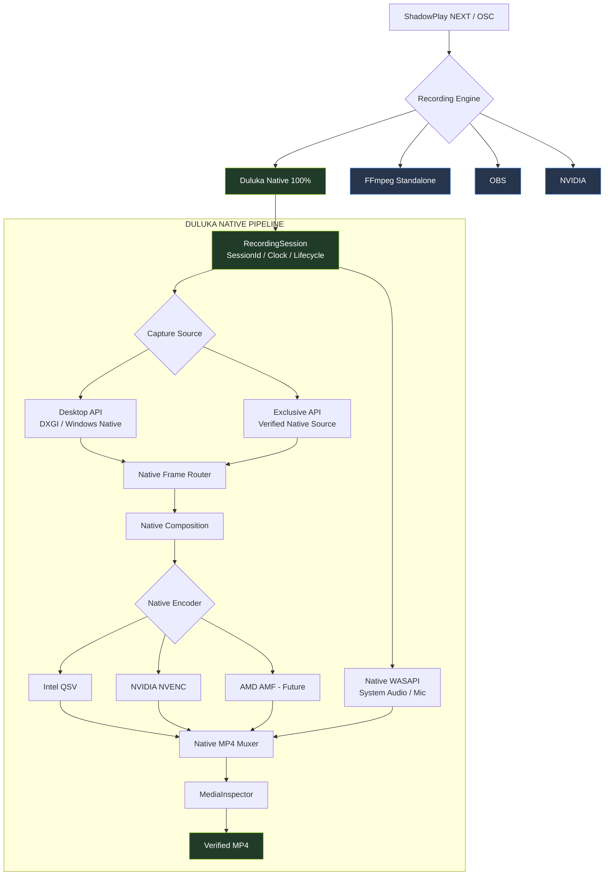

# EngineCapture — Duluka Capture Engine (แผนที่ระบบฉบับเดียว)

อัปเดต: 2026-10-29 · เครื่องพัฒนานี้ (NVIDIA: GTX 1080 Ti ×2) · งาน Intel/QSV อยู่อีกเครื่อง

สัญญาสถาปัตยกรรมหลัก: [SESSION-CENTRIC-RECORDING-CONTRACT](../../../docs/architecture/SESSION-CENTRIC-RECORDING-CONTRACT.md) (SPN-ADR-2026-10-24-SESSION-001) · [ฉบับภาษาไทย](../../../docs/architecture/SESSION-CENTRIC-RECORDING-TH.md)
เอกสารนี้คือ "แผนที่" ไม่ใช่ข้อกำหนด — หากขัดแย้งกับ Contract ให้ยึด Contract

---

## 1. สร้างและตรวจทั้งระบบด้วยคำสั่งเดียว

```powershell
# build ทั้ง 36 โปรเจกต์ + รันชุดทดสอบ device-free ทั้งหมด (ไม่จับหน้าจอ/ไม่เปิดไมค์)
powershell -ExecutionPolicy Bypass -File .\Invoke-EngineOfflineChecks.ps1

# build เฉยๆ
dotnet build EngineCapture.slnx -c Release
```

ผลล่าสุด (2026-10-29): **ENGINE_OFFLINE_CHECKS_PASS suites=26, build 0 error** — สรุปอยู่หัวข้อ 4

`LegacyCompletion.Tests` ถูกเว้นจาก solution เพราะต้อง DLL stage ที่ validate แล้ว:
`dotnet build LegacyCompletion.Tests -p:CaptureAssemblyPath=<staged>/NvCapture.dll`

---

## 2. ผังทำงาน (อนุมัติโดยเจ้าของ 2026-10-29) และการแมปเป็นไฟล์จริง

**ผังเป้าหมาย — ทำ Duluka Native ก่อน, Intel หยุดชั่วคราว (paused), AMF = future:** ผังนี้ยังไม่ใช่ pipeline ที่ใช้งานจริงทั้งหมด ดูสถานะด้านล่าง



**สถานะจริงของแต่ละบล็อกในผัง (2026-10-29):**

| บล็อกผัง | สถานะ | หมายเหตุ |
| --- | --- | --- |
| RecordingSession / Router / Composition | ✅ Wired | `CaptureSession.vb`, `SessionFrameRouter.vb` |
| Desktop API — DXGI | ✅ Wired + **live real-frame verified 2026-10-29** | ฉากทดสอบควบคุม: จอจริง→DXGI→NVENC→MP4 12s, 720/720 packet muxed+decoded, video-only |
| Desktop API — Windows Native (WGC) | ⚠️ มีโค้ด **ยังไม่ wire** | `WgcCapture/WgcFrameSource.cs` ไม่มีใครอ้าง |
| Exclusive API (Verified Native Source) | 🟡 **ระบบเลือก+ตรวจ+monitor พร้อมแล้ว (2026-10-29)** — `ExclusiveCapturePolicy` (fail-closed, เฉพาะ DXGI ที่ implement), `ExclusiveVerificationGate` (ต้องพิสูจน์เฟรมจริงบน target ปักหมุด), `DxgiDisplayModeMonitor` (bounded poll อ่านอย่างเดียว) — tests 24/24; **source แบบ game-hook ยังไม่มี** และการยืนยันต่อเกมจริงแต่ละ API ยังต้องทดสอบ (ตาม ADR §J) |
| Encoder NVENC | ✅ Wired, พิสูจน์ synthetic + E2E จริง | 1080 Ti บนเครื่องนี้ |
| Encoder Intel QSV | ⏸️ **หยุดชั่วคราว** — มีโค้ด NV12 path, fail-closed | งานต่ออยู่ใน `GLM-HANDOFF-INTEL-I2-20261029.md` |
| Encoder AMD AMF | 🔮 Future ตามผัง | ไม่มีโค้ด |
| Native WASAPI (System/Mic) | ✅ มีจริง (AudioEngineSession) | FFmpeg AudioSidecar ยังเป็น stub ตามสัญญา |
| Native MP4 Muxer | ❌ ยังไม่ wired | `CaptureSession` ใช้ FFmpeg `LiveMuxSession` จริง จึงยังไม่ผ่าน Native 100% |
| MediaInspector / MediaVerifier | ⚠️ Wired, ยังพึ่ง FFmpeg ในบางเส้นทาง | ต้องตรวจ full-decode และผล session ก่อน Saved; ไม่ใช่หลักฐานว่า mux เป็น native |

## 2.1 ชั้นระบบ: ADR component → ไฟล์จริง

```
RecordingEngine (VB) ───────────── Duluka Capture/Recording/DulukaEngine.Recording/RecordingEngine.vb
 └─ RecordingBackendFactory        คัด provider ตาม vendor/LUID — Intel ถูก fail-closed (Implemented=False)
 ├─ CaptureSession                 Recording/DulukaEngine.Recording/CaptureSession.vb (SessionId/Clock/State)
 ├─ FrameRouter                    Recording/DulukaEngine.Recording/SessionFrameRouter.vb
 ├─ DesktopFrameSource (DXGI)      Video/DXGI Desktop Duplication/DulukaEngine.Video.DXGI/DdagrabBackend*.vb
 ├─ VideoEncoder NVENC (VB)        Encoding/NVENC/DulukaEngine.Encoder.Nvenc/NvencEncoderBackend.vb
 ├─ VideoEncoder QSV (C#)          Encoding/Intel/DulukaEngine.Encoder.Qsv/QsvEncoderBackend.cs (path NV12 เท่านั้น)
 ├─ Audio WASAPI (C#)              Audio/DulukaEngine.Audio.Wasapi/ + Audio/DulukaEngine.Audio/AudioEngineSession.cs
 ├─ FFmpeg backend                 Recording/Backends/FFmpeg/DulukaEngine.FFmpegBackend/ (LiveMux ยังถูก Duluka ใช้งาน; ต้องย้ายออก)
 ├─ MediaInspector/MediaVerifier   Recording/Media/DulukaEngine.Media/SessionMediaVerifier.vb
 └─ ตัวขับจริง (CLI)               Tools/DulukaEngine.Recording.ConsoleDriver/ (โหมด --videocheck ใช้ config chain จริง)

โฮสต์ production:  ../NVIDIA Capture.vbproj (NvCapture.exe, REST :59077)  ← ตัวจบวงจร UI
Control plane:     OSC UI → NodeAPI :59011 → NvContainer :59012 → NvCapture :59077
```

## 3. สถานะจริงของแต่ละส่วน (ไม่ตกแต่ง)

| ส่วน | สถานะ | หลักฐาน |
| --- | --- | --- |
| DXGI Desktop Duplication (Ddagrab) | **Wired, ใช้ production** | `RecordingBackendFactory.CreateCapture` |
| Native NVENC H.264 | **Wired, ใช้ production** | synthetic 69/69 บน 1080 Ti จริง |
| Session กลาง (CaptureSession/Clock/Router) | **Wired** | Recording.Tests 41 pass, owned-frames path |
| FFmpeg engine (แยก) | **Wired** | Standalone แยกได้ แต่ปัจจุบัน Duluka ยังเรียก FFmpeg LiveMux ด้วย |
| MediaVerifier (ตัดสิน Saved) | **Wired** | Mux 25 + MediaEvidence 25 + decode integrity |
| QSV encoder (C#) | **มีโค้ด, fail-closed บน path BGRA/live** | `Providers intel:qsv-h264 Implemented=False` → `intel_native_live_input_not_verified`; path NV12 ใช้ได้ผ่าน `CreateEncoderForInput` |
| WgcCapture | **ไม่ถูก wire** — ไม่มีใคร reference | grep ทั้ง workspace |
| AudioSidecar.vb (FFmpeg) | **Stub ตามสัญญา** (no-op lifecycle) | หัวไฟล์ประกาศชัด |
| ExclusiveFrameSource / ModeMonitor สลับ Desktop↔Exclusive อัตโนมัติ | **ยังไม่ implement** (I4) | ADR §I |
| OBS/NVIDIA-engine ภายนอก | คง pipeline ของตัวเอง | ADR §B-12 |

## 4. ชุดทดสอบ (รันผ่านล่าสุดทั้งหมด)

| ชุด | ผล | พิสูจน์อะไร |
| --- | --- | --- |
| AudioOffline | 50 + 1,167 | timeline เสียง/สถานการณ์ขอบ/ไม่แตะอุปกรณ์จริง |
| CoreTests / ConfigTests / FrameContract | 14 / 95 / 8 | แกน config v2 + contract เฟรม |
| RecordingUnitTests | 41 pass, 5 skip | session lifecycle/stop hardening (มี stress 50×) |
| EncoderSynthetic | 69/69 | **NVENC จริงบน 1080 Ti** + config/GOP/preset mapping |
| B1 / I3DFrame / I3DWorker | 5 / 27 / 10 | quiescence + ownership เฟรม (fake frames ล้วน) |
| FFmpeg synthetic ×2 | 13 + 5 | mux lifecycle/audio intent |
| Routing / RouteGuard | 14 / 33 | ตาราง route + sandbox guards |
| Composition / DisplaySelection | 82 / 21 | factory/LUID/จอเสมือน (synthetic targets) |
| HardwareReadiness `--dxgi-only` | 8 | อ่าน metadata DXGI อย่างเดียว (ไม่แตะพิกเซล) |
| QsvNative contract/fault/media | 35 + 16 + 43 | สัญญา session (device-free) |
| QsvNativeHardwareGate | **SKIP** `no_eligible_intel_output` | เครื่องนี้ไม่มี Intel — ต้อง skip จริงใส่ crash |
| RecordingRecovery / SessionRecovery | 15 / 29 | กู้คืน + lifecycle ไฟล์จริง (lavfi) |
| MediaEvidence / Mux / DeepDecode / LongScan | 25 / 25 / 5 / 2 | หลักฐานไฟล์ + full decode + scan 1/5 นาที |

นอกชุดอัตโนมัติ — **พิสูจน์แล้ววันที่ 2026-10-29**:
1. `lavfi → h264_nvenc (1080 Ti) → MP4 → ffprobe 15/15 frames → SessionMediaInspector full-decode PASS` (เทียบเท่า Phase 7D; สคริปต์ตัวเต็มต้องมี worker :59077 idle จึงข้าม)
2. **Live real-frame validation (I3 เทียบเท่า, อนุมัติโดยผู้ใช้, video-only, ฉากทดสอบควบคุม `Show-CaptureTestScene` ปิดทุกจอ):**
   `จอจริง 1680×1050 → DXGI Desktop Duplication → native NVENC → MP4 12.00s → 720/720 packet muxed → full-decode 720/720 PASS`
   (captured 246 เฟรมจริง + 475 CFR duplicate = 720 encoded @60fps, nvenc_errors=0, audio_stream=MISSING ตามขอบเขต, ไม่มี orphan ffmpeg; ไฟล์ถูกลบหลังตรวจตามที่ประกาศ — ขับเคลื่อนด้วย `ConsoleDriver --videocheck --no-audio`)
3. **Live WITH system audio (2026-10-29 01:43, อนุมัติโดยผู้ใช้, mic ปิดสนิท, ฉากทดสอบ + โทน 440Hz):**
   12.00s ครบเป้า · video h264 720/720 · **audio AAC FOUND 2.3MB จริง (mean -13dB, max -0.4dB)** · A/V delta 60ms (เกณฑ์ 200ms) · full-decode ทั้งสอง stream ผ่าน · ไฟล์ลบแล้ว
   **Finding จริง 2 ชิ้น:** (a) `SessionMediaVerifier` ตัด `duration_mismatch` ที่ delta 60ms — เข้มกว่า granularity ของ AAC frame (padding ทำให้ 12.000s เป๊ะเป็นไปไม่ได้) ต้องมี owner ตัดสิน ปรับเกณฑ์หรือ trim; (b) config fps=30 พบ source fault `source_nonmonotonic_or_missing_qpc` ตั้งแต่ ~2s (fps=60 ปกติ) — ยังไม่ทราบรากเหตุ ต้องไล่ต่อ

**ไม่รันอัตโนมัติ (ต้องอนุมัติ/เงื่อนไข):**
- `DulukaEngine.Video.Tests` ส่วน DDAGRAB (เปิด Desktop Duplication จริง — ต้องฉากทดสอบไร้ความเป็นส่วนตัว)
- `ConsoleDriver` (อัดจริง) และ `IsolatedTest/Invoke-CaptureSmoke.ps1` (ต้อง confirm privacy ×2 + worker + pairing secret)
- `Invoke-CaptureOfflineGate.ps1` ตัวเต็ม (ต้อง worker :59077 พร้อม/idle)

## 5. สคริปต์

| สคริปต์ | บทบาท | เงื่อนไข |
| --- | --- | --- |
| `Invoke-EngineOfflineChecks.ps1` | **จุดเดียว**: build + รัน 26 ชุด | FFmpeg bundled + NvCapture.dll |
| `Invoke-CaptureOfflineGate.ps1` | release gate 8 ขั้นตอน | worker :59077 idle (fail-closed) |
| `Invoke-CaptureHardwarePreflight.ps1` / `...RelayReadOnlyPreflight.ps1` | เช็คฮาร์ดฯ/relay อ่านอย่างเดียว | ตามสคริปต์ |
| `Invoke-IsolatedNvencSyntheticSmoke.ps1` | NVENC จริง + inspector | worker idle |
| `Invoke-IntelCaptureI1/I2/I3Regression.ps1` | regression ฝั่ง Intel | **เครื่อง Intel เท่านั้น** |
| `IsolatedTest/Invoke-CaptureSmoke.ps1` | smoke E2E ผ่าน REST | privacy confirm ×2 + worker |

## 6. การเชื่อม UI osc / data osc — สถานะปัจจุบัน (source wired 2026-10-29, รอ deploy)

**เสร็จแล้วใน source** (Backend/Module แข็งแล้วตามคำสั่งผู้ใช้): mount shims ทั้ง 4 + record command relay +
state sync socket — รายละเอียดครบที่ [NODEAPI-CAPTURE-DATA-PLANE-20261029](../../Overlay%20On-Screen%20Control/NVIDIA%20NodeAPI/NODEAPI-CAPTURE-DATA-PLANE-20261029.md).
สรุป: UI → NodeAPI :59011 → Container :59012 (broker) → NvCapture :59077; ทุก write ต้อง `{"confirmed":true}`
+ double-gate (`NV_CAPTURE_RUNTIME_ENABLED=1` + Container `allowRecordCommands`); ห้ามแต่งผล started/saved;
สะพาน desired→actual เป็น opt-in (`NV_CAPTURE_DESIRED_BRIDGE=1`) เพราะ bus ที่ deploy มี worker poll desired เอง
ทดสอบ: capture/record/hotkey suites 74/74 ผ่าน (ชุด UI/CSS 17 fail เป็นของงาน parallel อื่น) — **ยังไม่ deploy/restart**

ช่องว่างเดิมที่วินิจฉัยตอนเช้า (shims ไม่ถูก mount → UI ได้ 404 ทั้งหมด) **ปิดแล้วใน source** — สิ่งที่เหลือคือ
deploy/restart ตามขั้นตอนของ Build + ตั้ง flag จริง + ยืนยันหน้างาน (ขั้นตอนอยู่ในเอกสาร data plane ด้านบน)

ประเด็นที่เกี่ยวแต่ไม่ใช่ NodeAPI: Container รายงาน `policyValid=false` (`FileNotFoundException` ของ capture routing policy) — เป็นของฝั่ง Container/Capture policy ตาม [NODEAPI-CAPTURE-STATUS-GET-FIX-20261024](../../Overlay%20On-Screen%20Control/NVIDIA%20NodeAPI/NODEAPI-CAPTURE-STATUS-GET-FIX-20261024.md)

## 7. เอกสาร phase (เรียงตามเวลา)

- แกนเอนจิน: PHASE1–4 (build→NVENC→audio→หยุดปลอดภัย) · PHASE5A–D (offline ชุดแรก)
- เสถียรภาพ/หลักฐาน: PHASE6A–H (stability→outcome→recovery→synthetic→MP4→scan→decode→**release gate**)
- ฮาร์ดแวร์: PHASE7A–D (preflight→LUID gate→DXGI topology→NVENC synthetic จริง) · PHASE8 (display/screenshot)
- อื่นๆ: [ENGINE-ROUTER.md](ENGINE-ROUTER.md) (ตาราง route engine), [Duluka Capture README](Duluka%20Capture/README.md)

## 8. กติกาที่ห้ามละ

- ห้ามเขียนทับ/commit ทับงาน concurrent (Codex) — ทุกอย่างที่เพิ่มที่นี่เป็น additive
- ห้ามจับหน้าจอ/ไมค์จริงโดยไม่มีฉากทดสอบ + ขอบเขตชัดเจน; synthetic/read-only ได้ในขอบเขตงาน
- ฟีเจอร์ที่ยังไม่ผ่าน live gate ต้องรายงานว่า Unverified — ห้ามเรียก "เสร็จ" จาก build หรือ UI เพียงอย่างเดียว
- งาน Intel (QSV native live, E2E audio Intel) อยู่เครื่อง Intel — ชุด `Invoke-IntelCaptureI*.ps1` + QsvNative โหมด hardware
