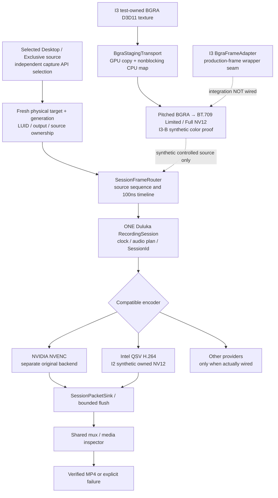

# NVIDIA Capture — MateBook Intel development map

**Machine/worktree:** HUAWEI-MateBook · `C:\My Project\NVIDIA-Shadowplay` · branch `intel/duluka-capture` · reviewed 25 October 2026.

This guide describes the **local experimental Intel/QSV worktree**, **not** the installed AORUS-DESKTOP runtime, the public `Stable` branch, or an available Intel Desktop recorder. Preserve the [accepted Session-Centric Recording Contract](../../docs/architecture/SESSION-CENTRIC-RECORDING-CONTRACT.md) and its [Thai companion](../../docs/architecture/SESSION-CENTRIC-RECORDING-TH.md): one Duluka RecordingSession owns SessionId, clock, audio plan, selected encoder, packet sink, mux/finalization and media evidence.

## Source and session ownership

The live Desktop/Fullscreen API slots are part of the **architecture**, not a guarantee of automatic mode switching. The I3 transport and adapter do **not** acquire game/desktop frames themselves. OBS and installed NVIDIA recording keep their independent engine-owned pipelines; do not route their frames into this Duluka session implicitly.

### New Intel I3-B / I3-C evidence (25 October, evening review)

**I3-B synthetic lifecycle/color milestone is complete:** [report](../../docs/reports/intel-duluka-i3b-2026-10-25/README.md) **2,056 passed / 0 failed / 33 skipped**, including 331 lifecycle/clock/ownership/color checks beyond 1,725-case composition. The earlier BC30002 compiler failure was an intermediate log; later documented I3-B runner completed. Native Intel private bridge moved to **ABI 3** with validated BT.709 Limited/Full tags in H.264 VUI and MP4; pair native/managed artifacts. The synthetic audio mux's 13 historical assertions were **Not Run** in this scope.

**I3-C synthetic SourceCompositionDriver:** [Agent A](../../docs/reports/intel-duluka-i3c-2026-10-25/A-COMPOSITION-REPORT.md) reran **1,935/0/0** scoped checks; [Agent C independent QA](../../docs/reports/intel-duluka-i3c-2026-10-25/C-INDEPENDENT-QA.md) reran **1,938/0/0** including B1 fake-worker tests, and recommended **acceptance for synthetic composition only**. The actual production DXGI source/factory is not wired. [Agent B's B1 fix](../../docs/reports/intel-duluka-i3c-2026-10-25/B-WORKER-QUIESCENCE-REPAIR.md) is synthetic-verified but does not close the worker-final-state race concern or B2–B8 hardware/lifecycle gaps. **Main acceptance is not established; `intel_native_live_input_not_verified` remains closed.** Read [dual-worktree status](../../docs/WORKTREE-STATUS-20261025.md). No I3-B/I3-C source was modified by this documentation sync.

## Verified milestones on this machine

| Scope | Evidence | Limit |
|---|---|---|
| **I1** | Physical adapter/output/target identification and guarded capture-policy tests on Intel UHD 8086:9B41. | Read-only inventory is not acquisition of desktop pixels. |
| **I2** | Owned synthetic CPU NV12 → native Intel QSV H.264 → existing session/packet sink → full-decode MP4. VBR and CQP positive cases. | Live native desktop input remains blocked; CBR negative control remains failed/rejected. |
| **I3 transport** | Controlled D3D11 BGRA → staging GPU CopyResource + bounded Map/Unmap → pitched CPU BGRA → owned NV12 → *same* QSV session. Reported **1,453 passed / 0 failed / 33 skipped** at its dated scope. | These were synthetic textures, not a real capture feed. |
| **I3 frame adapter / composition seam** | `BgraFrameAdapter` accepts borrowed production-shaped D3D11 frames with physical target, device, descriptor, generation and lifetime guards; owner report recorded **1,725 passed / 0 failed / 33 skipped** in 6 regression stages (13 earlier synthetic-audio mux cases expressly excluded). | Source adapter exists, but the default production Desktop factory and live worker are **not** connected. Tests do not certify audio or actual gameplay recording. |

**Hard gate remains `intel_native_live_input_not_verified`.** The tested hardware is an Intel UHD Graphics adapter with locally observed driver/runtime API 1.34. Intel libvpl dispatcher/source 2.16.0 does not mean the driver implementation supports API 2.x. Runtime LUID values are **boot/session observations, never compile-time constants**. QSV NV12 frame import, real game capture, Intel audio/AV sync and 1080p throughput have not been certified.

## Source navigation

- [Duluka Capture module map](EngineCapture/Duluka%20Capture/README.md) — overall layer ownership.
- [Intel QSV backend](EngineCapture/Duluka%20Capture/Encoding/Intel/README.md) — native bridge, VBR/CQP policy, lifetime and packet flush.
- [D3D11 BGRA transport](EngineCapture/Duluka%20Capture/Video/Transport/DulukaEngine.Video.Transport.D3D11/README.md) — strict device/texture identity and row-pitch/Map contract.
- `EngineCapture/Duluka Capture/Video/Transport/DulukaEngine.Video.Transport.D3D11/BgraFrameAdapter.cs` — most recent borrowed-frame-to-owned-NV12 seam, not an acquisition loop.
- [Historical top-level architecture](../../docs/ARCHITECTURE.md) — point-in-time map where superseded by the accepted contract.

## Reports and safe verification

- [I1 baseline](../../docs/reports/intel-duluka-i1-2026-10-24/README.md)
- [I2 native QSV / session evidence](../../docs/reports/intel-duluka-i2-2026-10-24/README.md)
- [I3 synthetic transport evidence](../../docs/reports/intel-duluka-i3-2026-10-25/README.md)
- [I3 borrowed frame / composition seam evidence](../../docs/reports/intel-duluka-i3-composition-2026-10-25/README.md) and [its six-stage exit-code manifest](../../docs/reports/intel-duluka-i3-composition-2026-10-25/checks.json)

Do not rerun broad suites without checking active development sessions and script behavior. The I3 report's reproduction script uses **test-owned synthetic frames** and no live desktop/audio input; the separately documented older I3 run includes 13 synthetic-audio assertions outside the latest composition-only scope.

No live display, system-loopback audio or microphone capture is authorized by this documentation task. Do not enable production `Desktop` Intel selection, alter the NVIDIA NVENC lane, bypass a runtime guard, stage/commit/push, or deploy to AORUS as a shortcut. Always distinguish **Source → Build → Synthetic Pass → Live Capture → Final Media Validation → Deployment**.
