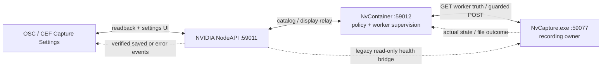
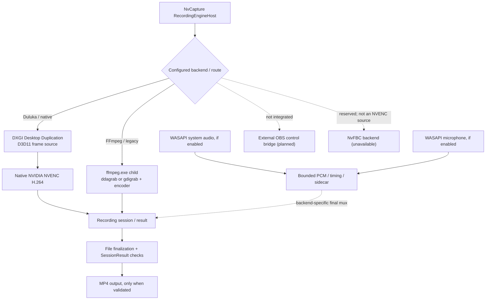

# NVIDIA Capture — engine and media ownership

**Status: active development, 24 October 2026.** `NVIDIA Capture` owns the actual display capture, recording, screenshots, encoder/audio pipelines and worker runtime. `NVIDIA Container` forwards validated requests but must never fabricate media files or claim success from a status-only response.

## Capture system architecture (24 October 2026)

These diagrams describe **source ownership and contracted interfaces**, not a claim that every path is deployed, enabled, or production-certified. The control plane (HTTP/status/UI) is separate from the media plane (GPU frames, audio and files).

### 1. Control plane — OSC, Container and NvCapture

- **NvCapture.exe** owns recording sessions, selected display, screenshots and saved-file outcomes. `GET /health`, `/state`, `/engines`, `/displays` report worker-side facts when supported by the *installed* revision.
- **NvContainer** supervises the worker and validates/relays `GET /v1/capture/{status,engines,capabilities,displays}` and guarded record/display/screenshot commands. It does not capture pixels or encode media.
- **NodeAPI** serves OSC-facing `DulukaCapture` status/catalog/display shims and legacy compatibility routes. Some legacy health/status reads are direct read-only calls to NvCapture; **do not assume every old OSC Record/Enable toggle uses the Container command gateway**.
- **Write safety:** Container recording writes are default-denied (`captureRuntime.allowRecordCommands=false`); display selection and screenshot have separate default-denied flags. Allowed commands require per-request confirmation and compatible live worker identity/readiness. Browser loopback/Origin guards do **not** authenticate all same-user local processes.
- **Record state truth:** requested enable/disable, actual recording, session completion and verified saved file are different states. The UI may show a *saved* notification only after a successful finalized session with real file evidence, not merely a toggle or HTTP 200.

### 2. Media plane — backend-specific sources and outputs

**Independent screenshot path:** `NvCapture display inventory (adapter LUID + output index)` → selected output → **FFmpeg ddagrab single-frame capture** → PNG write / structural PNG check → saved screenshot. Screenshot capture does **not** start the recording session or use NVENC; the worker must confirm `saved=true` with a real file. Selection may take effect on the next engine rebuild. Legacy installed NVIDIA ShadowPlay is a separate route; it must not be confused with experimental NvFBC.

**Backend eligibility:** the current `CaptureBackendRoute` treats native Duluka as DXGI Desktop Duplication + native **NVENC_H264**. The FFmpeg family accepts only listed capture API/encoder pairs subject to installed-binary/runtime verification. OBS integration and the NVIDIA-family NvFBC source are **not automatically available** merely because they appear in a catalog. The separate *Pipeline Design* tab in OSC is a **non-persisted UI preview**, not backend activation.

### 3. Status, tests and acceptance gates

- Dated controlled preflight observed **idle/ready** on NvCapture, Container and NodeAPI and passed synthetic NVENC/video-only MP4 and no-hardware recovery checks. That does **not** prove one real DXGI → native NVENC → audio mux → UI toast end-to-end recording.
- Real Capture API selection, real screenshots, actual audio/microphone recording, A/V sync, finalized media, and complete CEF readback require their own controlled acceptance runs. Do not capture a user's screen/audio or change capture writes merely to validate a diagram.
- Replays are **not production-ready**; the documented Container replay command returns `501`. A route in source, isolated mocks, a staged Build and the actively running NvCapture binary are separate evidence levels.

**Primary evidence:** [Capture worker readiness preflight](CONTROLLED-RECORD-PREFLIGHT-20261024.md) · [backend router and status](EngineCapture/ENGINE-ROUTER.md) · [realtime FFmpeg/audio design](ENGINE-REALTIME-ARCHITECTURE.md) · [Container worker contract](../NVIDIA%20Container/CAPTURE-COMMUNICATION-HUB-CONTRACT-20261024.md) · [Display/screenshot relay](../NVIDIA%20Container/CAPTURE-DISPLAY-RELAY-CONTRACT-20261024.md) · [verified saved-notification policy](RECORD-TOAST-TRUTH-AUDIT-20261024.md).

---

## 25 October 2026 — Capture UI vs Capture Engine

The newer [Video Capture / Advanced Capture UI v77](../Overlay%20On-Screen%20Control/NVIDIA%20NodeAPI/osc/mods/CAPTURE-UI-REDESIGN-20261025.md) is a scoped NVIDIA-style layout/route update. The developer report records **32/32 UI checks**, 4/4 Source-vs-Build asset hashes, and an Advanced CEF geometry check with no overlap; **the Video Capture CEF visual check is still open**. It did **not** alter NvCapture's recording engine, NVENC/audio code, Container gateway authorization or turn the Pipeline Design preview into a persisted API/encoder selector. The **Control and Media planes in the diagrams above are unchanged**.

## Source navigation

- `NVIDIA Capture.vbproj` — application/worker project definition.
- `src/` — application routes and current Capture integration.
- `EngineCapture/Duluka Capture/` — modular capture engine source: DXGI, WGC, audio, encoder, recording and tests.
- `tests/` — Capture-specific regression and validation.
- [Duluka Capture source map](EngineCapture/Duluka%20Capture/README.md)

## Current contract and limitations

NvCapture's worker API is described by [Container's Capture communication contract](../NVIDIA%20Container/CAPTURE-COMMUNICATION-HUB-CONTRACT-20261024.md) and [display/screenshot relay](../NVIDIA%20Container/CAPTURE-DISPLAY-RELAY-CONTRACT-20261024.md). The recorded worker route set includes `/health`, `/state`, `/engines`, guarded record commands, `/displays`, `/display/select` and `/screenshot` depending on the installed worker revision.

- A route in **source** does not prove that the installed NvCapture worker implements it.
- Display selection is identity-checked and may apply only after engine rebuild.
- Screenshot success requires a verified saved file, not merely HTTP 200.
- Replay is not considered ready; the documented Container replay route responds 501.
- Native NVENC, FFmpeg, audio/video sync and real game/window capture require pipeline-specific tests and compatible drivers/hardware.

[Historical REST integration proposal](README-REST-INTEGRATION.md) describes an older API/polling design; **do not substitute its port or protocol for current NvCapture/Container worker contracts**.

Never deploy an Engine update while recording without protecting finalization and preserving rollback backups.

## Intel Capture development source (25 October snapshot)

The MateBook Intel/QSV development notes have been preserved in [MateBook Intel development map](MATEBOOK-INTEL-DEVELOPMENT-20261025.md). Current source must be verified with build, tests and live hardware gates; merging source does not certify Intel recording.

