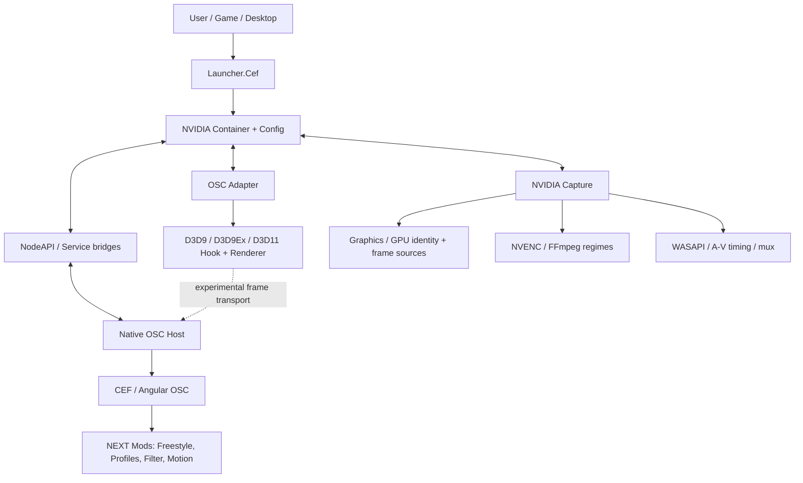

<!-- SHADOWPLAY NEXT | Flagship ReBuild | Public engineering overview -->
<div align="center">

# SHADOWPLAY NEXT

**Language:** **English** · [ภาษาไทย](README.th.md)

### FLAGSHIP BUILD. **FLAGSHIP REBUILD.**

**THE INTERFACE YOU KNOW. THE POSSIBILITIES YOU DON'T.**

An independent Windows overlay and game-capture platform in the middle of a full architectural rebuild.

[](https://github.com/ScotcsDuluka/ShadowPlay-NEXT/commits/Stable)
[](https://github.com/ScotcsDuluka/ShadowPlay-NEXT/commits/Stable)
[](#release-roadmap)
[](#release-roadmap)
[](#requirements-and-compatibility)

**[PROJECT WEBSITE](https://scotcsduluka.github.io/ShadowPlay-NEXT/)** ·
**[LIVE DEVELOPMENT](https://github.com/ScotcsDuluka/ShadowPlay-NEXT/commits/Stable)** ·
**[ISSUES](https://github.com/ScotcsDuluka/ShadowPlay-NEXT/issues)** ·
**[DISCORD](https://discord.gg/v5qUGVD3jZ)**

</div>

> [!IMPORTANT]
> **Two generations. One evolving vision.** **NVIDIA ShadowPlay OBT3** is the existing legacy release. **ShadowPlay NEXT** is a different, heavily rebuilt development generation — **CBT1 is planned, not publicly released**. The target for **NEXT OBT1 is January 1, 2027** (01.01.2570 in the Thai Buddhist calendar). A target date is not a guarantee of availability.
>
> **Unofficial project.** Not affiliated with, endorsed by, or sponsored by NVIDIA Corporation. NVIDIA, GeForce, ShadowPlay and associated marks are owned by their respective owners. See [Licensing & provenance](#licensing-and-provenance).

---

## This is not just another update

The original project explored the ShadowPlay experience through **VB.NET / Windows Forms**, an independent desktop UI and capture stack.

NEXT is the bigger bet: **CEF-based OSC integration, a native Host, extensible UI modules, renderer / Hook experiments, an evolving Capture engine, game-aware services, and a real cross-process architecture**.

The recognizable NVIDIA-style interface is still part of the experience. Behind it, the implementation is changing fast.

> **OBT3 built the flagship. NEXT rebuilds the flagship.**
>
> *The Git history currently moves faster than the changelog. This README is a curated overview, not a promise that every development branch or local runtime build is already published.*

### One project, two eras

| | NVIDIA ShadowPlay — OBT3 | ShadowPlay NEXT — CBT1 / OBT1 |
|---|---|---|
| Generation | Legacy flagship | New platform / active rebuild |
| UI | VB.NET / WinForms overlay | Original NVIDIA-style OSC resources with CEF / Angular integration and project-specific mods |
| Architecture | Legacy desktop and recording paths | Native OSC Host, NodeAPI, Container, Adapters, Graphics, Capture and Launcher components |
| Customization | Legacy controls | Freestyle V5 layout editor, native-menu integration and game/profile extensions |
| Release state | **OBT3 available** | **CBT1 planned**; **OBT1 targeted for 01.01.2027** |
| Download | [OBT3 release](https://github.com/ScotcsDuluka/NVIDIA-Shadowplay/releases/tag/Release-OBT-3) | **No public CBT1 installer announced** |

<details>
<summary><b>See the legacy overlay</b> — an earlier generation, not a NEXT screenshot</summary>

<br>


The old UI is part of the project's history. The live NEXT interface and integration tests are changing independently; this image must not be used as proof that a new NEXT build has shipped.

</details>

## Release roadmap

| Milestone | Who gets access? | What it means | Status |
|---|---|---|---|
| **NVIDIA ShadowPlay OBT3** | Public | Existing legacy flagship release | **Available** |
| **ShadowPlay NEXT CBT1** | Selected testers, once recruitment launches | First focused external verification of the rebuilt platform | **In preparation; applications not yet live** |
| **ShadowPlay NEXT OBT1** | Intended public testing | The first open test of the NEXT generation | **Target: 2027-01-01** |
| **ShadowPlay NEXT 1.0** | Public when ready | Release after compatibility, safety and reliability gates | **No date promised** |

**The point of CBT1 is evidence, not hype.** We want repeatable results for overlay lifecycle, input routing, capture integrity, GPU/adapter compatibility, and game-specific behavior **before** expanding access.

There is **no registration form linked here yet**. An application page will be linked only when it actually exists and is ready to accept entries.

---

## What's being built

**Legend:** `Implemented / testing` means code and selected tests exist; it does **not** mean publicly released or universally compatible. `Experimental` means real-world verification is incomplete. `Planned` is not an implemented feature.

| System | What exists or is being integrated | Engineering state |
|---|---|---|
| **OSC / Native Host** | CEF + Angular interface, native Host integration, NVIDIA-style controls, route/input lifecycle | **Implemented / testing** |
| **Freestyle V5** | Drag-and-drop Main-menu Groups and Controls, Small / Side / Big layouts, Auto-Fill, Undo / Done / Cancel, native `md-menu` and `md-select` | **Implemented / testing** |
| **OSC Motion** | Original-style transitions, preflight layout positioning, native lifecycle integration | **Implemented; open/close QA ongoing** |
| **Game Profiles** | Game detection, catalog/profile routing and configurable UI paths | **Active integration** |
| **Game Filter** | ReShade effects/preset integration and OSC control surface | **Experimental integration** |
| **DirectX Adapter / Hook** | D3D9/D3D9Ex and DXGI/D3D11 renderer paths, shared-frame transport work | **Experimental; per-API gates** |
| **NVIDIA Capture** | Capture backends, GPU identity checks, video/audio pipelines and reliability work | **Active engineering; not a blanket production claim** |
| **Encoding & audio** | Native NVENC and FFmpeg engine regimes; WASAPI, timing, mux and integrity validation | **Implementation varies by regime** |
| **NVIDIA Container / Config** | Process supervision, configuration and inter-component orchestration | **Active integration** |
| **Launcher / Gallery / Localization** | Desktop launch flow, media management and English/Thai UI paths | **Under continued development** |

The screen shown in the overlay is **not** a compatibility certificate. A visible button, a compiled Hook, or an enabled menu is not proof that the related end-to-end feature is ready for all games.

### Freestyle V5 — make the Main-menu yours

- Arrange Groups across the left, center and right panels.
- Compose **Big**, **Side** and **Small** Blocks with different slot layouts.
- Drag, swap, insert and reassign Controls without cloning the original NVIDIA menu nodes.
- Keep a single Settings Control; protect layout invariants.
- Preview changes, **Undo**, **Done** or **Cancel** while keeping saved settings intact until confirmation.
- Respect OSC Motion, native control behavior and locale changes.

**Engineering evidence, 2026-10-23:** the selected offline V5 regression suite passed **135 / 135** tests; an earlier combined real-CEF interaction/viewport/lifecycle run passed **18 / 18** checks. A subsequent source-preview audit verified closed/idle native controls but **did not pass a live Native Host activation/open-cycle gate**. These are **dated, scoped results**, not an all-build release certification.

**Read:** [Freestyle V5 QA gate](Project/Overlay%20On-Screen%20Control/NVIDIA%20NodeAPI/tools/FREESTYLE-V5-RELEASE-QA-20261023.md) · [CEF RAF / Host activation audit](Project/Overlay%20On-Screen%20Control/NVIDIA%20NodeAPI/tools/FREESTYLE-V5-CEF-RAF-AUDIT-20261023.md)

---

## Architecture — the rebuild underneath

This is a **conceptual ownership map**, not a claim that every transport is production-ready.



### Where the source lives

```text
Project/
├── Launcher.Cef/                 Desktop / CEF launcher integration
├── NVIDIA Container/             Native supervision and orchestration
├── NVIDIA Config/                Runtime and service configuration
├── NVIDIA Graphics/              Graphics-facing components
├── NVIDIA Capture/               Capture and recording engines
├── NVIDIA Adapter/               API probes, Hook and render adapters
├── Overlay On-Screen Control/
│   ├── NVIDIA NodeAPI/
│   │   ├── osc/                   CEF UI and OSC mods
│   │   ├── tests/                 Node-level and integration regressions
│   │   └── tools/                 QA and controlled source/runtime tools
│   └── NVIDIA OSC/               Native Host
└── FFmpeg/                        FFmpeg-related integration
```

**Source is not Runtime.** The development source tree, local generated builds, installed runtime, and GitHub's public `Stable` branch can be at **different revisions**. Development builds may depend on local prerequisites and are not automatically equivalent to a public release.

### Supported API reality

The current adapter has implemented D3D9/D3D9Ex and D3D11 paths, with different levels of test evidence. Detection of graphics modules is **not** proof of actual rendering support. D3D10, D3D12, Vulkan and OpenGL should **not** be advertised as implemented render paths based on passive probes.

See [Hook implementation status](Project/NVIDIA%20Adapter/OSC%20Adapter/Duluka%20Hook/IMPLEMENTATION-STATUS.md) for dated test results and limitations.

---

## Proof over promises

Some examples from subsystem-specific validation records:

| Evidence snapshot | Observed result | What it **doesn't** prove |
|---|---|---|
| Freestyle V5 Node regression — **2026-10-23** | **135 passed / 0 failed** in the selected suite | Public release readiness |
| Real OSC CEF combined checks — **2026-10-23** | **18 / 18** previously passed | All future runtime builds |
| Later OSC CEF source preview — **2026-10-23** | 12 native controls observed; closed/idle state checked | A successful Native Host open transition |
| D3D11 Hook smoke — **2026-10-22** | **9 Presents / 6 composed frames** in the recorded test | General game compatibility |
| DX9 interactive smoke — **2026-10-22** | Foreground automation blocked that run | A passing real-game DX9 test |

Current focus includes **capture correctness and honest failure reporting**, **GPU adapter/LUID safety**, **host-to-hook synchronization**, **clean OSC motion and input**, and **regressions across game-specific conditions**.

- [Recent code history](https://github.com/ScotcsDuluka/ShadowPlay-NEXT/commits/Stable)
- [Build and deployment policy](docs/BUILD-DEPLOY-POLICY.md)
- [Capture architecture notes](Project/NVIDIA%20Capture/ENGINE-REALTIME-ARCHITECTURE.md)
- [Repository rebuild plan — proposal, not a completed migration](docs/REPOSITORY-REBUILD-PLAN.md)

> [!WARNING]
> Avoid assuming a new commit is already installed or that a GitHub Pages deployment has been updated. **A code change, a passing test, a deployed runtime and a public installer are four different things.**

---

## Requirements and compatibility

- **Platform:** Windows x64 is the current target family; exact supported versions must be validated per release.
- **GPU / encoder:** Requirements depend on the selected pipeline. **Native NVENC requires a compatible NVIDIA GPU and driver.** FFmpeg-based regimes may provide additional choices where the relevant backend is available and verified.
- **Runtime:** The **legacy OBT3** application targets **.NET 10 Desktop Runtime**. NEXT component prerequisites are still being consolidated and may differ by build.
- **Games:** Anti-cheat, integrity level, graphics API, fullscreen mode, adapter configuration and protected content may affect behavior. No blanket compatibility or protected-content bypass is promised.
- **Performance:** No universal FPS/latency/zero-overhead claim. Publish measurements with hardware, settings and test methodology.

### Downloads

**Looking for something you can install now?** Use the **[legacy OBT3 release page](https://github.com/ScotcsDuluka/NVIDIA-Shadowplay/releases/tag/Release-OBT-3)** and read that release's requirements. It is **not** ShadowPlay NEXT CBT1.

**Looking for NEXT CBT1?** It is in preparation. **No public installer or application page is represented as available here yet.**

Do not install arbitrary development binaries from Git history and assume they are a signed-off test release.

---

## Contributing and engineering discipline

This repository is developing quickly across several simultaneous workstreams. **Please keep changes scoped.**

1. Read the relevant source owner, contract, status file and test instructions first.
2. Use a dedicated branch for external contributions when practical.
3. Commit only files you actually own or intentionally change; never sweep unrelated dirty files into a commit.
4. Run appropriate targeted tests and document scope, environment and limitations.
5. Treat source, staged builds, installed runtime and public release artifacts separately.
6. Open a focused Pull Request with reproduction steps and evidence.

Large dependency or repository moves should follow a reviewed plan, not a bulk rename. See [Repository rebuild plan](docs/REPOSITORY-REBUILD-PLAN.md) and [Build/deploy policy](docs/BUILD-DEPLOY-POLICY.md).

**Do not submit proprietary NVIDIA assets, extracted binaries, credentials, private user data or unlicensed third-party materials.**

## Licensing and provenance

This is an **independent, unofficial** project. It is **not NVIDIA software**, and it has no claimed NVIDIA endorsement.

The repository includes a [MIT license](LICENSE) and [third-party notices](LICENSE.NOTICE) for applicable project-owned code and attributed dependencies. **A repository-level MIT file does not grant rights to NVIDIA-owned UI assets, other proprietary materials, or third-party components licensed under separate terms.** Check file-level notices and provenance before reuse, distribution or packaging. Public availability is **not** a license to redistribute everything in the tree.

The current architecture incorporates original-style NVIDIA OSC resources and project-specific modifications. The rights to any upstream/proprietary materials must be reviewed independently before including them in distributable CBT1/OBT1 artifacts.

**Trademark notice:** NVIDIA, GeForce, ShadowPlay and their associated visual identities are trademarks of NVIDIA Corporation or their respective owners.

---

## Project and community

Created and developed by **[ScotcsDuluka](https://github.com/ScotcsDuluka)**, with test contributions and feedback from the community, including **ApiwitKaemanee** (legacy QA credit).

- **[ShadowPlay NEXT site](https://scotcsduluka.github.io/ShadowPlay-NEXT/)** — site content is being rebuilt; pages may show earlier releases until updated.
- **[OBT3 legacy site](https://scotcsduluka.github.io/NVIDIA-Shadowplay/obt3.html)** — the previous flagship generation.
- **[Development commits](https://github.com/ScotcsDuluka/ShadowPlay-NEXT/commits/Stable)** — source history, not deployment receipts.
- **[Issues](https://github.com/ScotcsDuluka/ShadowPlay-NEXT/issues)** — bug reports and reproducible cases.
- **[Discord community](https://discord.gg/v5qUGVD3jZ)** — discussion and announcements.

<details>
<summary><b>ภาษาไทย — สรุปแผน ShadowPlay NEXT</b></summary>

<br>

**จาก Flagship Build สู่ Flagship ReBuild**

- **NVIDIA ShadowPlay OBT3:** รุ่นเดิม เปิดให้ใช้งานแล้ว
- **ShadowPlay NEXT CBT1:** รุ่นทดสอบกลุ่มแรก กำลังเตรียมระบบและการเปิดรับสมัคร ยังไม่ประกาศเปิดให้สมัครจริง
- **ShadowPlay NEXT OBT1:** เป้าหมายเปิดทดสอบสาธารณะ **1 มกราคม 2570**
- โค้ดกำลังพัฒนาเร็วมาก ผลทดสอบแต่ละระบบไม่ใช่การรับรองว่า NEXT ทั้งชุดพร้อมแจกแล้ว
- โปรเจกต์นี้เป็นโครงการอิสระ **ไม่ใช่ผลิตภัณฑ์อย่างเป็นทางการของ NVIDIA**

</details>

<div align="center">

---

### **THE FLAGSHIP WAS BUILT. NOW IT'S BEING REBUILT.**

**SHADOWPLAY NEXT · CBT1 IN PREPARATION · OBT1 TARGET: 01.01.2027**

*You've only seen the surface.*

</div>
