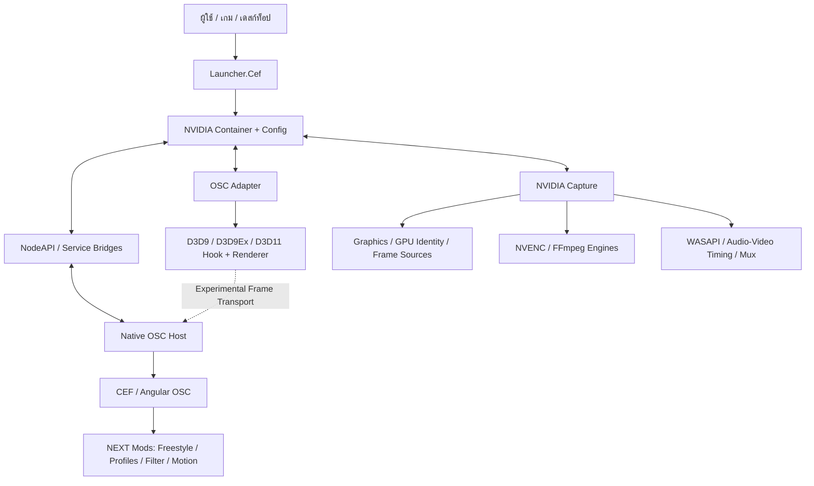

<!-- SHADOWPLAY NEXT | Flagship ReBuild | Thai edition -->
<div align="center">

# SHADOWPLAY NEXT

**ภาษา:** [English](README.md) · **ไทย**

### FLAGSHIP BUILD. **FLAGSHIP REBUILD.**

**หน้าตาที่คุณคุ้นเคย กับความเป็นไปได้ที่ยังไม่เคยเห็น**

โปรเจกต์ Overlay และระบบบันทึกเกมบน Windows ที่กำลังสร้างสถาปัตยกรรมใหม่อย่างจริงจัง

[](https://github.com/ScotcsDuluka/ShadowPlay-NEXT/commits/Stable)
[](https://github.com/ScotcsDuluka/ShadowPlay-NEXT/commits/Stable)
[](#แผนการเปิดตัว)
[](#แผนการเปิดตัว)
[](#ความต้องการของระบบและความเข้ากันได้)

**[เว็บไซต์โปรเจกต์](https://scotcsduluka.github.io/ShadowPlay-NEXT/)** ·
**[ประวัติการพัฒนา](https://github.com/ScotcsDuluka/ShadowPlay-NEXT/commits/Stable)** ·
**[รายงานปัญหา](https://github.com/ScotcsDuluka/ShadowPlay-NEXT/issues)** ·
**[Discord](https://discord.gg/v5qUGVD3jZ)**

</div>

> [!IMPORTANT]
> **สองยุคของโปรเจกต์ วิสัยทัศน์เดียวกัน**
>
> **NVIDIA ShadowPlay OBT3** คือรุ่นเดิมที่เผยแพร่แล้ว ส่วน **ShadowPlay NEXT** คือโปรเจกต์ยุคใหม่ที่อยู่ระหว่างการ ReBuild อย่างหนัก **CBT1 ยังไม่เปิดเผยแพร่ต่อสาธารณะ** และ **OBT1 ตั้งเป้าเปิดวันที่ 1 มกราคม 2570 (2027)** วันที่ดังกล่าวเป็นเป้าหมาย ไม่ใช่การรับประกันว่าจะเปิดได้ตามกำหนด
>
> **โครงการอิสระ ไม่ใช่ผลิตภัณฑ์อย่างเป็นทางการของ NVIDIA** ไม่มีความเกี่ยวข้อง การสนับสนุน หรือการรับรองจาก NVIDIA Corporation เครื่องหมายการค้าของ NVIDIA, GeForce และ ShadowPlay เป็นของเจ้าของสิทธิ์ที่เกี่ยวข้อง อ่านเพิ่มที่ [สิทธิ์และที่มาของซอฟต์แวร์](#สิทธิ์และที่มาของซอฟต์แวร์)

---

## นี่ไม่ใช่แค่การอัปเดตธรรมดา

จุดเริ่มต้นของโปรเจกต์คือการสร้างประสบการณ์ ShadowPlay ผ่าน **VB.NET / Windows Forms** พร้อมระบบหน้าตาโปรแกรมและการบันทึกภาพที่พัฒนาขึ้นเอง

แต่ **NEXT** ไปไกลกว่านั้น ทั้งการเชื่อมต่อ **OSC บน CEF**, **Native Host**, ระบบ UI Mods, การทดลอง **Renderer / Hook**, การพัฒนา Capture Engine, บริการตรวจจับเกม และสถาปัตยกรรมที่ทำงานร่วมกันผ่านหลายโปรเซส

รูปลักษณ์แบบ NVIDIA ที่คุ้นเคยยังคงอยู่ ขณะที่ระบบเบื้องหลังถูกพัฒนาใหม่อย่างรวดเร็ว

> **OBT3 คือ Flagship Build ส่วน NEXT คือ Flagship ReBuild**
>
> *ความเร็วของการพัฒนาบางช่วงนำหน้า Changelog ไปแล้ว README นี้จึงเป็นภาพรวมของงานที่ตรวจสอบได้ ไม่ใช่คำยืนยันว่าโค้ดทุกส่วนในเครื่องนักพัฒนาถูก Push หรือเผยแพร่เป็นตัวติดตั้งแล้ว*

### โปรเจกต์เดียว สองยุค

| หัวข้อ | NVIDIA ShadowPlay — OBT3 | ShadowPlay NEXT — CBT1 / OBT1 |
|---|---|---|
| ยุคของโปรเจกต์ | Flagship รุ่นเดิม | แพลตฟอร์มยุคใหม่ที่กำลัง ReBuild |
| UI | Overlay จาก VB.NET / WinForms | ทรัพยากร OSC สไตล์ NVIDIA บน CEF / Angular พร้อม Mods ของโปรเจกต์ |
| สถาปัตยกรรม | ระบบ Desktop และ Recording รุ่นเดิม | Native OSC Host, NodeAPI, Container, Adapter, Graphics, Capture และ Launcher |
| การปรับแต่ง | ชุด Controls รุ่นเดิม | Freestyle V5, Native Menu และระบบเชื่อมต่อโปรไฟล์เกม |
| สถานะ | **เปิดให้ใช้ OBT3 แล้ว** | **เตรียม CBT1** และ **ตั้งเป้า OBT1 วันที่ 01.01.2027** |
| ดาวน์โหลด | [รุ่น OBT3](https://github.com/ScotcsDuluka/NVIDIA-Shadowplay/releases/tag/Release-OBT-3) | **ยังไม่ประกาศตัวติดตั้ง CBT1 แบบสาธารณะ** |

<details>
<summary><b>ชมภาพ Overlay รุ่นเดิม</b> — เป็นภาพ Legacy ไม่ใช่ภาพ ShadowPlay NEXT</summary>

<br>


ภาพนี้เป็นส่วนหนึ่งของประวัติโปรเจกต์ ไม่ควรนำไปอ้างว่าเป็นหลักฐานว่ารุ่น NEXT ถูกเผยแพร่แล้ว

</details>

## แผนการเปิดตัว

| ระยะ | ผู้เข้าถึง | จุดประสงค์ | สถานะ |
|---|---|---|---|
| **NVIDIA ShadowPlay OBT3** | ผู้ใช้ทั่วไป | Flagship รุ่นเดิม | **เปิดให้ใช้งานแล้ว** |
| **ShadowPlay NEXT CBT1** | ผู้ทดสอบที่ได้รับคัดเลือก เมื่อเปิดรับสมัคร | ทดสอบแพลตฟอร์ม ReBuild ในวงจำกัด | **กำลังเตรียมการ ยังไม่เปิดรับสมัคร** |
| **ShadowPlay NEXT OBT1** | ตั้งใจเปิดให้ผู้ใช้ทั่วไปทดสอบ | Open Beta รุ่นแรกของ NEXT | **เป้าหมาย: 1 ม.ค. 2570** |
| **ShadowPlay NEXT 1.0** | ผู้ใช้ทั่วไปเมื่อระบบพร้อม | รุ่นที่ผ่านเกณฑ์เสถียรภาพและความเข้ากันได้ | **ยังไม่กำหนดวัน** |

**CBT1 ต้องเน้นหลักฐานการทำงานจริง ไม่ใช่แค่ความตื่นเต้นจาก Trailer** โดยเฉพาะวงจรเปิด/ปิด Overlay, การส่ง Input, ความสมบูรณ์ของไฟล์วิดีโอ, ความเข้ากันได้ของ GPU/Adapter และพฤติกรรมที่แตกต่างกันตามเกม

**ยังไม่มีลิงก์รับสมัคร CBT1 ใน README นี้** เพราะยังไม่เปิดหน้าสมัครจริง เมื่อตัวระบบรับสมัครพร้อมจึงค่อยเพิ่มลิงก์

---

## กำลังสร้างอะไรอยู่บ้าง?

**คำอธิบายสถานะ:** `พัฒนาแล้ว / อยู่ระหว่างทดสอบ` หมายถึงมีโค้ดและผลทดสอบเฉพาะบางส่วน **ไม่เท่ากับเปิดให้ใช้งานจริงกับทุกเกม**; `ทดลอง` หมายถึงยังขาดการยืนยันในสถานการณ์จริง; `วางแผน` ไม่ได้หมายความว่าใช้งานได้แล้ว

| ระบบ | สิ่งที่มีหรือกำลังเชื่อมต่อ | สถานะด้านวิศวกรรม |
|---|---|---|
| **OSC / Native Host** | หน้าตา CEF + Angular, เชื่อม Native Host, NVIDIA Controls และวงจร Route/Input | **พัฒนาแล้ว / กำลังทดสอบ** |
| **Freestyle V5** | ลากจัด Main-menu, Group/Control, Block แบบ Small / Side / Big, Auto-Fill, Undo / Done / Cancel พร้อม `md-menu` และ `md-select` จริง | **พัฒนาแล้ว / กำลังทดสอบ** |
| **OSC Motion** | Transition, การจัดตำแหน่งล่วงหน้า และการทำงานร่วมกับวงจร Native OSC | **พัฒนาแล้ว / ยังตรวจ Open-Close** |
| **Game Profiles / GPU Preferences** | จัดการโปรไฟล์รายแอปจากไฟล์ `.exe`, ตั้งชื่อ, เลือก GPU Adapter และกำหนด Windows Graphics Preferences ผ่าน NVIDIA Graphics Backend พร้อม Control เสริมใน Freestyle V5 | **ผู้พัฒนาทดสอบบนโน้ตบุ๊กจริง: พบ GPU แยกกัน เลือกการ์ดได้ เกมเรนเดอร์ผ่าน GPU ที่เลือกจริง และค่าที่บันทึกยังอยู่หลัง Restart** |
| **ApplicationOntology / ฐานข้อมูลเกม** | แค็ตตาล็อก Game Identity แยกที่ `C:\\My Project\\nv-ontology-pages` มีข้อมูลเกม ชื่อ `.exe` คำใบ้ Graphics API และการแจ้งอัปเดต | **แค็ตตาล็อกในเครื่อง v1.2.8 / 8 รายการ (24 ต.ค. 2569); ยังไม่ยืนยันว่า Public API อัปเดตแล้ว; การจับคู่ชื่อไฟล์ไม่ใช่ SHA-256 Identity** |
| **Game Filter** | การเชื่อม ReShade Effect/Preset กับหน้า OSC | **ทดลอง / ยังตรวจการเชื่อมจริง** |
| **DirectX Adapter / Hook** | มีโค้ด Native D3D9/D3D9Ex และ D3D11 พร้อมชุดทดสอบ DX9Ex GPU-to-GPU IPC ข้ามโปรเซสและ x86/x64 | **ทดลองอยู่; ยังไม่รับรอง Auto-Hook เกมจริง อัตราเฟรม หรือความเข้ากันได้ทุกเกม** |
| **NVIDIA Capture** | Capture และ Encoder, ตรวจจอด้วย DXGI, เลือกจอ, Screenshot Engine และ Container Relay | **มีโค้ดและผลทดสอบเฉพาะส่วน; ยังไม่รับรอง Record/Replay และ UI End-to-End Runtime** |
| **Encoder & Audio** | Native NVENC กับ FFmpeg หลายโหมด, WASAPI, Timing, Mux และ Integrity Checks | **ความพร้อมแตกต่างกันตาม Engine** |
| **NVIDIA Container / Config** | ควบคุมโปรเซส, GameWatcher, Capture Relay, ตรวจคำขอและประสานโมดูล | **กำลังทดสอบ; Source, Staged Build และ Runtime ที่รันอยู่อาจไม่ตรงกัน** |
| **Launcher / Modules** | CEF Command Center, เมนู 11 โมดูล, รายงานสถานะติดตั้ง/ทำงาน, ภาษาไทย/อังกฤษ และต้นแบบ Appearance Profiles | **พัฒนาแล้ว/กำลังทดสอบ; แค่มีปุ่มเมนูไม่ใช่ตัวติดตั้งหรือการรับรองว่าทุกโมดูลทำงานแล้ว** |
| **Gallery / Media** | NodeAPI Recent, CopyFile, Metadata และ MSE/Seek Bridge | **ชุดทดสอบ Backend ผ่าน แต่ยังไม่ยืนยัน Play/Seek ใน CEF จริง; Delete ตอบ 501** |

**สองระบบนี้ไม่ใช่สิ่งเดียวกัน:** Game Profiles ใน OSC ใช้จัดการค่าการเลือก GPU รายแอปผ่านบริการ NVIDIA Graphics ในเครื่อง ส่วน ApplicationOntology เป็นระบบแค็ตตาล็อกและการระบุเกม/แจ้งอัปเดต **ไม่ได้เก็บหรือ Apply โปรไฟล์ GPU ของผู้ใช้** ดู [nv-ontology.pages.dev](https://nv-ontology.pages.dev/) และ [ซอร์ส ApplicationOntology-API](https://github.com/ScotcsDuluka/ApplicationOntology-API) โดยการแก้ข้อมูลใน Repository บนเครื่องไม่ได้หมายความว่า Deploy ขึ้นเว็บแล้ว

การเห็นปุ่มบนหน้าจอ **ไม่ได้แปลว่าระบบเบื้องหลังพร้อมใช้แล้ว** เช่น การตรวจพบ DirectX Module ไม่ใช่หลักฐานว่า Hook รองรับเกมนั้น และการแสดงปุ่มอัดวิดีโอก็ไม่ใช่หลักฐานว่าไฟล์ที่ได้สมบูรณ์

### Freestyle V5 — จัด Main-menu ในแบบของคุณ

- แบ่งตำแหน่ง **Group** ได้ทั้งด้านซ้าย กลาง และขวา
- สามารถเพิ่ม **Game Profiles Control** ของ NEXT นอกเหนือจาก Controls NVIDIA เดิม 12 ตัว โดยการเข้าใช้และสถานะจริงขึ้นกับ NVIDIA Graphics Backend ในเครื่อง
- เลือก **Big / Side / Small Block** และรูปแบบ Slot
- ลากสลับ ย้าย และเพิ่ม Controls โดยไม่โคลน NVIDIA Menu Nodes ต้นฉบับ
- รักษา **Settings Control เพียงตำแหน่งเดียว** และตรวจสอบเงื่อนไข Layout
- ทดลองแก้ไขด้วย **Undo / Done / Cancel** โดยไม่บันทึก Draft จนกว่าจะยืนยัน
- รองรับ OSC Motion, รูปแบบ Native Control และการเปลี่ยนภาษา

**หลักฐานวันที่ 23 ตุลาคม 2569:** ชุดทดสอบ Node ที่เลือกสำหรับ V5 ผ่าน **135 / 135** และการทดสอบ Interaction/Viewport/Lifecycle บน CEF จริงในรอบก่อนหน้าผ่าน **18 / 18** **แต่หลังจากนั้น Source เพิ่ม Game Profiles เป็น Control เสริมตัวที่ 13 (จากเดิม 12 ตัวของ NVIDIA) ผลทดสอบเก่าจึงยังไม่รับรองฟีเจอร์ที่เพิ่มใหม่** อย่างไรก็ตาม การทดสอบ Source Preview ครั้งถัดมาผ่านเฉพาะสถานะ Closed/Idle แต่ **ยังไม่ผ่านเกณฑ์ Native Host เปิด Overlay จริง** ตัวเลขนี้เป็นผลเฉพาะเวอร์ชันและขอบเขตที่ทดสอบ ไม่ใช่การรับรอง Release ทั้งชุด

อ่านรายงาน: [Freestyle V5 QA](Project/Overlay%20On-Screen%20Control/NVIDIA%20NodeAPI/tools/FREESTYLE-V5-RELEASE-QA-20261023.md) · [CEF RAF / Native Host Audit](Project/Overlay%20On-Screen%20Control/NVIDIA%20NodeAPI/tools/FREESTYLE-V5-CEF-RAF-AUDIT-20261023.md)

---

## สถาปัตยกรรมเบื้องหลัง Flagship ReBuild

ผังนี้เป็น **ภาพรวมความรับผิดชอบของระบบ** ไม่ใช่คำรับรองว่าการเชื่อมต่อทุกเส้นทางพร้อมใช้งานในรุ่น Public



### โครงสร้าง Source Code

```text
Project/
├── Launcher.Cef/                 ตัวเปิดโปรแกรมและระบบ CEF
├── NVIDIA Container/             บริการควบคุมโปรเซส
├── NVIDIA Config/                การตั้งค่าระบบ
├── NVIDIA Graphics/              ส่วนที่เกี่ยวข้องกับ Graphics
├── NVIDIA Capture/               Capture / Recording Engine
├── NVIDIA Adapter/               API Probe, Hook และ Render Adapter
├── Overlay On-Screen Control/
│   ├── NVIDIA NodeAPI/
│   │   ├── osc/                   OSC UI และ Mods
│   │   ├── tests/                 ชุดทดสอบระบบ
│   │   └── tools/                 QA และเครื่องมือตรวจสอบ Runtime
│   └── NVIDIA OSC/               Native Host
└── FFmpeg/                        ส่วนที่เชื่อมต่อ FFmpeg
```

**Source ไม่ใช่ Runtime:** โค้ดใน Repository, ไฟล์ Build ที่สร้างในเครื่อง, Runtime ที่ติดตั้งอยู่ และ Branch `Stable` บน GitHub อาจ **ไม่ใช่เวอร์ชันเดียวกัน** การ Commit โค้ดใหม่ไม่ได้ทำให้ Runtime หรือ Installer อัปเดตอัตโนมัติ

### ความจริงของการรองรับ Graphics API

Adapter มีโค้ดรองรับเส้นทาง D3D9/D3D9Ex และ D3D11 แล้ว แต่ผลทดสอบจริงยังแตกต่างกันตาม API และสถานการณ์ **การตรวจพบ Graphics Module ไม่ใช่หลักฐานว่าเรนเดอร์ Overlay ได้จริง**

อย่าเพิ่งโฆษณา D3D10, D3D12, Vulkan หรือ OpenGL ว่าเป็น Renderer ที่รองรับแล้วเพียงเพราะมีตัวตรวจจับ API

อ่าน [สถานะการพัฒนา Hook](Project/NVIDIA%20Adapter/OSC%20Adapter/Duluka%20Hook/IMPLEMENTATION-STATUS.md) เพื่อดูผลทดสอบและข้อจำกัด ณ เวลาที่บันทึก

---

## มีหลักฐานก่อนค่อยประกาศว่าพร้อม

ตัวอย่างหลักฐานที่บันทึกไว้จากการทดสอบเฉพาะระบบ:

| การทดสอบ | ผลที่บันทึกไว้ | สิ่งที่ **ยังยืนยันไม่ได้** |
|---|---|---|
| Freestyle V5 Node Regression — **23 ต.ค. 2569** | **135 ผ่าน / 0 ไม่ผ่าน** ในชุดที่เลือก | NEXT พร้อมเป็น Public Release |
| OSC CEF Combined — **23 ต.ค. 2569** | **18 / 18 ผ่าน** ในรอบที่บันทึก | Runtime ใหม่ทุก Build จะผ่านเหมือนกัน |
| OSC CEF Source Preview รอบถัดมา — **23 ต.ค. 2569** | พบ Native Controls ครบ 12 และตรวจ Closed/Idle แล้ว | การเปิด Native Host สำเร็จตลอดวงจร |
| ทดสอบ Game Profiles บนโน้ตบุ๊กหลาย GPU — **ผู้พัฒนารายงาน 24 ต.ค. 2569** | พบ GPU แยกกัน เลือกการ์ดได้ เกมเรนเดอร์ผ่าน GPU ที่เลือกจริง และบันทึกค่าไว้ได้หลัง Restart | ยังไม่ได้ยืนยันซ้ำอย่างอิสระหรือกับเกมและ GPU ทุกประเภท |
| D3D11 Hook Smoke — **22 ต.ค. 2569** | **9 Presents / 6 Composed Frames** | ใช้งานได้กับทุกเกม |
| DX9 Interactive Smoke — **22 ต.ค. 2569** | เครื่องมือทดสอบติดข้อจำกัด Foreground Window | ผ่านการทดสอบ DX9 กับเกมจริง |

งานหลักที่กำลังให้ความสำคัญคือ **ความถูกต้องของข้อมูล Capture**, **รายงานความล้มเหลวตามจริง**, **GPU Adapter / LUID Safety**, **Host-Hook Synchronization**, **OSC Motion/Input ที่ไม่รบกวนเกม** และ **Regression Tests**

- [ประวัติ Commit ล่าสุด](https://github.com/ScotcsDuluka/ShadowPlay-NEXT/commits/Stable)
- [นโยบาย Build และ Deploy](docs/BUILD-DEPLOY-POLICY.md)
- [รายละเอียดสถาปัตยกรรม Capture](Project/NVIDIA%20Capture/ENGINE-REALTIME-ARCHITECTURE.md)
- [แผนจัดระเบียบ Repository](docs/REPOSITORY-REBUILD-PLAN.md) — ยังเป็นแผน ไม่ใช่การย้ายโปรเจกต์ที่เสร็จแล้ว

> [!WARNING]
> **Commit โค้ดผ่าน ≠ Tests ผ่าน ≠ Deploy Runtime สำเร็จ ≠ เปิดให้ดาวน์โหลด Public Installer แล้ว**
>
> อย่าตีความว่า GitHub Pages และโปรแกรมในเครื่องอัปเดตทันกันเสมอ โดยเฉพาะเมื่อมีหลายระบบพัฒนาพร้อมกัน

---

## ความต้องการของระบบและความเข้ากันได้

- **แพลตฟอร์ม:** พัฒนาสำหรับ Windows x64 เป็นหลัก รุ่น Windows ที่รองรับจริงจะต้องระบุและตรวจสอบในแต่ละ Release
- **GPU / Encoder:** ขึ้นอยู่กับ Pipeline; **Native NVENC ต้องใช้ NVIDIA GPU และ Driver ที่รองรับ** ส่วน FFmpeg อาจมีทางเลือกอื่นเมื่อ Backend นั้นพร้อมและผ่านทดสอบ
- **Runtime:** **OBT3 รุ่นเดิมใช้ .NET 10 Desktop Runtime** ส่วนข้อกำหนดของ NEXT ต้องสรุปตาม Build ที่จะเผยแพร่อีกครั้ง
- **เกม:** ระบบป้องกันโกง, ระดับสิทธิ์โปรเซส, Graphics API, Fullscreen Mode, GPU/Adapter และ Protected Content อาจส่งผลต่อการใช้งาน ไม่มีการรับประกันว่าจะใช้ได้กับทุกเกมหรือข้ามระบบป้องกันเนื้อหาได้
- **ประสิทธิภาพ:** ไม่กล่าวอ้างว่า FPS ไม่ตก, ไม่มี Latency หรือไม่มี Overhead โดยไม่มีผลวัดจริงพร้อมรายละเอียด Hardware/Settings

### ดาวน์โหลด

**ต้องการติดตั้งโปรแกรมที่เปิดให้ใช้แล้วตอนนี้?** ใช้ [NVIDIA ShadowPlay OBT3 รุ่นเดิม](https://github.com/ScotcsDuluka/NVIDIA-Shadowplay/releases/tag/Release-OBT-3) และอ่านข้อกำหนดของ Release นั้นก่อน

**ต้องการทดสอบ ShadowPlay NEXT CBT1?** โปรเจกต์ยังเตรียมการอยู่ **ยังไม่มีการประกาศตัวติดตั้งหรือหน้าเปิดรับสมัครแบบ Public ที่นี่**

ไม่ควรดาวน์โหลดไฟล์ Build ที่พบระหว่างการพัฒนามาติดตั้งแล้วถือว่าเป็นเวอร์ชันที่ผ่านการรับรอง

---

## การมีส่วนร่วมและระเบียบการพัฒนา

Repository นี้กำลังเปลี่ยนแปลงอย่างรวดเร็วจากหลายส่วนของระบบ **ขอให้แยกขอบเขตงานและรักษาข้อมูลของกันและกัน**

1. อ่านเอกสาร Owner/Contract/สถานะ/Tests ที่เกี่ยวข้องก่อนแก้ไข
2. หากเป็นผู้ร่วมพัฒนาภายนอก ควรใช้ Branch แยกเมื่อเหมาะสม
3. Commit เฉพาะไฟล์ที่รับผิดชอบ **ห้ามรวมไฟล์ Dirty ของงานอื่นโดยไม่ตรวจสอบ**
4. รัน Tests ที่เกี่ยวข้องและบันทึกสภาพแวดล้อม ข้อจำกัด และหลักฐาน
5. แยก Source, Build ที่เตรียมไว้, Runtime ที่ติดตั้ง และ Public Release ออกจากกัน
6. ส่ง Pull Request ที่ตรวจสอบได้ พร้อมขั้นตอนทำซ้ำปัญหา

การย้ายไฟล์จำนวนมากหรือแยก Repository ต้องผ่านการตรวจ Dependency และแผนย้อนกลับก่อน ดู [Repository Rebuild Plan](docs/REPOSITORY-REBUILD-PLAN.md) และ [Build/Deploy Policy](docs/BUILD-DEPLOY-POLICY.md)

**ห้ามส่งรหัสผ่าน ข้อมูลส่วนตัว ไฟล์กรรมสิทธิ์ของ NVIDIA ไฟล์ที่แกะจากผลิตภัณฑ์โดยไม่ได้รับอนุญาต หรือส่วนประกอบที่ไม่มีสิทธิ์เผยแพร่**

## สิทธิ์และที่มาของซอฟต์แวร์

นี่คือ **โปรเจกต์อิสระที่ไม่เป็นทางการ** ไม่ใช่ผลิตภัณฑ์ของ NVIDIA และไม่ได้รับการรับรองจาก NVIDIA

Repository มี [ไฟล์ MIT License](LICENSE) และ [Third-Party Notices](LICENSE.NOTICE) สำหรับโค้ดของโปรเจกต์และส่วนประกอบที่ระบุไว้ **MIT License ระดับ Repository ไม่ได้ให้สิทธิ์ในการเผยแพร่ NVIDIA Assets, ไฟล์กรรมสิทธิ์ หรือองค์ประกอบจากบุคคลที่สามซึ่งใช้สัญญาอนุญาตอื่น** ต้องตรวจต้นทางและสิทธิ์ของแต่ละไฟล์ก่อนนำไปแจกจ่าย

สถาปัตยกรรมปัจจุบันมีทรัพยากร NVIDIA OSC แบบต้นฉบับและ Mods ที่พัฒนาเพิ่มเติม **การใช้ในเครื่องเพื่อพัฒนา กับการรวมไฟล์เหล่านี้ในตัวติดตั้ง CBT1/OBT1 สำหรับเผยแพร่ เป็นคนละเรื่องที่ต้องตรวจสิทธิ์โดยตรง**

**เครื่องหมายการค้า:** NVIDIA, GeForce และ ShadowPlay รวมถึงเอกลักษณ์ทางภาพ เป็นเครื่องหมายการค้าของ NVIDIA Corporation หรือเจ้าของที่เกี่ยวข้อง

---

## ผู้พัฒนาและชุมชน

สร้างและพัฒนาโดย **[ScotcsDuluka](https://github.com/ScotcsDuluka)** พร้อมความช่วยเหลือด้านการทดสอบและข้อเสนอแนะจากชุมชน รวมถึง **ApiwitKaemanee** (เครดิต QA ของยุค Legacy)

- **[เว็บไซต์ ShadowPlay NEXT](https://scotcsduluka.github.io/ShadowPlay-NEXT/)** — อยู่ในช่วง ReBuild เนื้อหาเว็บไซต์บางส่วนอาจยังเป็นรุ่นเดิม
- **[เว็บไซต์ OBT3 รุ่นเดิม](https://scotcsduluka.github.io/NVIDIA-Shadowplay/obt3.html)**
- **[ประวัติ Commit](https://github.com/ScotcsDuluka/ShadowPlay-NEXT/commits/Stable)** — ประวัติ Source Code ไม่ใช่หลักฐานว่า Deploy แล้ว
- **[GitHub Issues](https://github.com/ScotcsDuluka/ShadowPlay-NEXT/issues)** — รายงานบั๊กพร้อมขั้นตอนทำซ้ำ
- **[Discord Community](https://discord.gg/v5qUGVD3jZ)** — ข่าวสารและการพูดคุย

<div align="center">

---

### **THE FLAGSHIP WAS BUILT. NOW IT'S BEING REBUILT.**

**SHADOWPLAY NEXT · เตรียม CBT1 · เป้าหมาย OBT1: 01.01.2027**

*สิ่งที่คุณเห็น เป็นเพียงส่วนหนึ่งเท่านั้น*

**[English](README.md) · ไทย**

</div>
