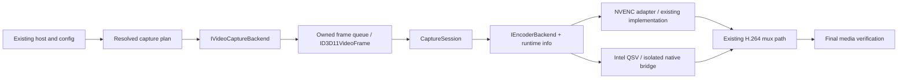

# Intel Duluka Capture — source audit and architecture handoff

I1 follow-up: implementation is complete locally; see [I1 results](reports/intel-duluka-i1-2026-10-24/README.md) and [I2 handoff](INTEL-DULUKA-CAPTURE-I2-HANDOFF.md). The audit below records the pre-I1 state and design rationale.

Date: 2026-10-24 (Asia/Bangkok). Machine: HUAWEI-MateBook.
Branch: `intel/duluka-capture`. Audited HEAD: `015f0548f82b5c1ed4d9c352fe095cc55e9a5453`.

**Stage A is complete: analysis, hardware probes, baseline checks and design only. Stop here for the user's model change. No production source was changed.**

The complete `C:\My Project\INTEL-DULUKA-CAPTURE-HANDOFF.md` was read. No applicable AGENTS.md was found in the repository or checked ancestor directories. No commit, push, deployment, application launch, desktop capture, screenshot, microphone or loopback recording was performed. All generated video came from FFmpeg `lavfi color` / `testsrc2`. Synthetic MP4s remain in the local temporary directory; their paths are recorded with the evidence.

## 1. What is actually established

| Check on this machine | Result | Limit of the evidence |
| --- | --- | --- |
| OS GPU inventory | Intel UHD Graphics, PCI 8086:9B41, driver 27.20.100.8984; Parsec Virtual Display Adapter also installed | PnP entries do not map one-to-one to DXGI entries |
| CPU / SDK | Intel Core i3-10110U; .NET 10.0.402 | No performance claim |
| Read-only DXGI enumeration | Three adapters; two Intel entries, one Microsoft entry; only Intel index 0 owns an attached output | No `DuplicateOutput` or `AcquireNextFrame` call |
| Auto-selected QSV, 128×128 black synthetic frame → null | Exit 0, one encoded packet; log explicitly reports hardware acceleration | Does not identify actual device LUID or prove a recording |
| Explicit QSV D3D11 child adapter 0, same synthetic input | Exit 0; device 8086:9B41; dispatcher API 2.16, implementation 1.34 | CLI reports index/vendor/device, not the actual encoder device's LUID |
| QSV VBR synthetic MP4 | 320×180, 30 fps, 2 s; 60 declared / 60 packets / 60 decoded frames; encode/probe/full-decode exit 0 | One small synthetic case, not native Duluka or live display capture |
| QSV CQP synthetic MP4 | Same dimensions/duration; 60/60/60 frames/packets; encode/probe/full-decode exit 0 | Same limitations |
| QSV CBR synthetic MP4 | Encode exit 0, 60 declared frames and 60 readable packets, **only 28 decoded frames**, NAL errors, full-decode exit -1094995529 | **Failed media acceptance.** Root cause is not isolated |
| Main Release build | PASS, 0 errors, 3 warnings in this invocation | Incremental build; handoff's earlier warning count was 10 |
| Selected device-free baseline suites | 181 checks PASS | Not the full release gate or NVIDIA hardware regression |

DXGI snapshot (LUIDs are this boot's identities, never hard-code them):

| DXGI adapter | Vendor | LUID high:low | Attached outputs |
| --- | --- | --- | --- |
| 0 | Intel 0x8086 | `00000000:0000bf60` | Output 0, 1920×1080, primary origin |
| 1 | Intel 0x8086 | `00000000:0001127a` | None |
| 2 | Microsoft 0x1414 | `00000000:0000c2ac` | None |

The existing `HardwareReadiness.Tests --dxgi-only` successfully enumerated metadata and then **failed** its NVIDIA-required assertion. This is an expected platform mismatch in that existing gate, not a passing Intel preflight. Do not identify the second Intel entry as Parsec without further mapping evidence.

Evidence and reproduction details: [local evidence index](reports/intel-duluka-2026-10-24/README.md).

## 2. Source findings that determine the design

Paths in this section are repository-relative. Line numbers refer to the audited HEAD.

| Source | Finding / implication |
| --- | --- |
| `Project/NVIDIA Capture/src/[API]/CaptureBackendRoute.vb:45` | Native Duluka accepts only NVENC H.264. QSV names are allowed in the separate FFmpeg route, not the native runtime. Keep rejecting native QSV until a backend is wired and proven. |
| `src/[API]/CaptureDisplayCatalog.vb:49` | Enumeration selects the first NVIDIA adapter and returns no displays on this machine. Persisted choice includes LUID and output index, but inventory is NVIDIA-only. |
| `src/[API]/RecordingEngineHost.vb:40` | `ApplySavedCaptureDisplay` resolves the saved LUID but forwards only `OutputIndex`. Target identity is lost before native initialization. |
| `EngineCapture/Duluka Capture/Video/DXGI Desktop Duplication/DulukaEngine.Video.DXGI/DdagrabBackend.vb:280` | DXGI initialization independently selects first NVIDIA; `RequestedOutputIndex` is local to that adapter. Existing access-lost recovery and texture ownership are useful and should be retained. |
| `Encoding/NVENC/DulukaEngine.Encoder.Nvenc/Internal/D3D11DeviceFactory.vb:91` | NVENC's own device factory requires NVIDIA. Leave this vendor implementation intact. |
| `Recording/DulukaEngine.Recording/RecordingEngine.vb:31` | Fields are concrete `DdagrabBackend` and `NvencEncoderBackend`; creation, rebuild and disposal are also concrete. A simple field-type replacement is insufficient: runtime FPS, dimensions, bitrate and adapter identity are outside `IEncoderBackend`. |
| `Recording/DulukaEngine.Recording/RecordingEngine.vb:150,354` | Initial initialization compares actual capture and encoder LUIDs. The encoder rebuild path needs the same validation before swapping instances. |
| `Recording/DulukaEngine.Recording/CaptureSession.vb:81,220` | Constructor/field depend on concrete NVENC. Capture diagnostics and dimensions also use concrete DXGI properties. |
| `Encoding/DulukaEngine.Encoder/Contract/IEncoderBackend.vb` | Useful common contract already exists: borrowed frame, caller-owned packet, bounded flush/stop and state transitions. `Encode=False` ambiguously covers delay and backpressure; do not assume a delayed QSV frame was rejected and resubmit it. |
| `Video/Contracts/DulukaEngine.Video/Contract/ID3D11VideoFrame.vb` | Existing frame exposes `NativeTexture As Object` and shared NT handle. Same-adapter LUID is necessary but does not make a foreign-device texture directly usable. Preserve shared-resource synchronization and lifetime. |
| `Recording/DulukaEngine.Recording/CaptureSession.vb:1051` | Session calls `Stop()` without explicitly delivering `Flush(sink)` output to mux. Current synchronous NVENC flush produces no packets; a delayed QSV backend would need an explicit drain path. |
| `src/[FFmpeg]/FFmpegArgumentBuilder.vb:42` | Legacy QSV already uses `hwdownload,format=bgra,format=nv12` to avoid historical hwmap failures. Its `output_idx` is not bound to a D3D11 adapter. Saved WGC monitor mapping is deliberately rejected. |
| Same file, QSV rate-control and scale branches | `-rc cbr` is ignored by this bundled QSV encoder: a synthetic test logged VBR. Custom-size QSV composition appends another `hwdownload` after the existing CPU conversion; this is a source-level defect to regression-test, not a live-capture failure proven today. |
| `Core/DulukaEngine/FFmpeg/FFmpegCommandBuilderV2.vb:189` | QSV builder differs from legacy: min/max/buffer plus lookahead. Neither builder should be treated as the authoritative native Intel policy. |
| `Video/Windows Graphics Capture/WgcCapture/WgcFrameSource.cs` | Static HWND/WebView overlay source with callbacks, not a monitor backend implementing `IVideoCaptureBackend`. Reuse ideas, not the overlay runtime itself. |
| `EngineCapture/Routing/BackendCatalog.cs` and `PipelineRouter.cs` | Catalog distinguishes in-process texture transport from FFmpeg child transport and correctly keeps plans non-runnable. Native/FFmpeg QSV endpoints are absent. |
| `src/[API]/CaptureMediaInspector.vb:182,240` | Existing packet scan and optional full decoder are reusable. Today's corrupt CBR file demonstrates that packet counts alone cannot certify playable media. |
| `Recording/DulukaEngine.Recording/RecordingDTOs.vb:359` | `SessionResult.Pass` includes NVENC-named error count and stream/file evidence. Introduce generic encoder and verification evidence without silently changing old serialized meanings. |

`src/` paths above are under `Project/NVIDIA Capture/`; the shorter Encoding/Video/Recording/Core paths are under `Project/NVIDIA Capture/EngineCapture/Duluka Capture/`.

## 3. Architecture decision

**Recommended production target: retain native Duluka orchestration and add an isolated Intel QSV encoder implementation behind the existing frame/encoder contracts.** Keep FFmpeg capture+QSV as a separately identified process-owned route and diagnostic/reference path. Do not label the existing legacy command line as a completed native Intel backend.

Reasons: native composition can bind and inspect actual D3D11 device LUIDs, retain current bounded queues/timestamps/mux ownership, and support both DXGI and a future WGC monitor source without leaking NVENC details. A bare FFmpeg CLI can select a current adapter index but does not provide the required actual-device LUID attestation in its existing logs. Source at the bundled revision also falls back to default device creation if adapter lookup yields no adapter; merely passing a requested index is insufficient proof.

### Shared boundaries

1. Add neutral `AdapterIdentity` and `CaptureTarget` values: LUID low/high, output index, monitor identity/geometry, topology generation. Adapter index is diagnostic/interop data only, never persistent identity. Resolve against fresh inventory on start and device recreation. LUIDs are not durable across reboot; saved selections must be revalidated, never silently remapped to another monitor.
2. Inventory all adapters/outputs read-only. Record vendor/device IDs, software flag, attachment, rotation and monitor handle. Resolve the Intel provider only to an eligible Intel output; no silent Parsec/software/default-adapter fallback. When identity or topology is ambiguous, return a reason rather than guessing. Do not infer physical hardware from a vendor number alone.
3. Add factory/composition seams and supplemental runtime-info interfaces for actual device identity, capture geometry/format, encoder output geometry/FPS/bitrate and generic diagnostics. Keep `IVideoCaptureBackend`, `ID3D11VideoFrame`, `IEncoderBackend` and packet ownership compatible.
4. Wrap existing NVENC in a composition adapter that implements the new info surface. Leave `Encoding/NVENC` code and the AORUS runtime untouched. Preserve the old default route/constructor behavior through the legacy provider; Intel selection is explicit. Shared DXGI source gets an explicit target-selection path, not a replacement of the NVIDIA vendor constant with Intel.
5. Refactor creation **and rebuild** to factories; validate requested target = actual capture LUID = actual encoder LUID before any frame handoff or encoder swap. Disposal races and existing bounded shutdown behavior remain required.
6. Keep requested/selected/actual capture API, encoder, rate-control and target identity in the session snapshot. Never share NVENC preset strings (`p4`) with Intel preset semantics.

### Intel encoder implementation

Proposed ownership: `Encoding/Intel/DulukaEngine.Encoder.Qsv/` plus a small native bridge project with a C ABI compiled against versioned Intel headers. Avoid hand-written guesses at packed Media SDK structs. Use the dispatcher to negotiate the installed hardware implementation; this machine's observed runtime is API **1.34**, so do not require modern 2.x surface-sharing APIs just because the dispatcher is newer.

- Native bridge takes a D3D11 device created for the resolved Intel LUID, binds it to the QSV session, reads back/validates the device identity, and fails on software implementation or mismatch. Intel documents device-handle sharing through `MFXVideoCORE_SetHandle`; keep the device alive through session close. [Intel device management](https://intel.github.io/libvpl/latest/API_ref/VPL_func_vidcore.html), [hardware acceleration](https://intel.github.io/libvpl/latest/programming_guide/VPL_prg_hw.html).
- First prove hardware H.264 from **owned synthetic NV12 system-memory surfaces**, with no desktop backend initialized. Start with truthful VBR/CQP settings; CBR remains unverified/disabled for this machine/profile pending the reproduced corruption investigation. Never silently downgrade a requested rate-control mode.
- Then add BGRA-to-NV12 conversion and scaling within the Intel implementation. A bounded readback/software conversion path is acceptable for correctness; GPU video processing is an optimization requiring a separate format/capability probe. Explicit color range, matrix, stride, alignment, crop and rotation handling are required. A 128×128 encoder probe says nothing about 1080p60 cost.
- Open shared textures on the encoder device when the capture device differs; same LUID alone is not permission to call `CopyResource` across devices. Finish copying borrowed input into encoder-owned storage before returning; retained surfaces must survive asynchronous QSV processing.
- For the first implementation, use bounded synchronous submission with no B frames/lookahead and one outstanding operation. Busy retries happen internally without duplicate input submission. If a frame is accepted but produces no immediate packet, retain its timestamp/owned surface and deliver it on later output/flush. Never count packets as submitted frames.
- Call `Flush(packetSink)` before encoder stop/mux completion; write every drained packet and preserve PTS/DTS. Add a supplemental submission result only if the existing Boolean contract cannot express required backpressure safely; keep NVENC compatibility through the wrapper.
- Produce packet format and SPS/PPS/IDR behavior expected by the current raw-H.264 mux input; verify the first and last frames, not only codec headers. No direct MP4-writing responsibility belongs in the encoder.

Native prerequisite: `vswhere.exe` exists, but the VC tools query returned no installation and neither `cl` nor `cmake` was found in the current PATH. Locate/establish the native toolchain and dispatcher/header packaging during implementation. No packages or drivers were installed during this audit. The independent native QSV bridge remains unimplemented and untested; FFmpeg success does not certify it.

### Separate FFmpeg route

Existing process ownership, job object handling and media inspection can support an interim Intel FFmpeg route, but it must remain named as such. Use a new Intel-specific argument policy rather than changing NVIDIA arguments. Build one conversion/scale chain; do not repeat `hwdownload`. Bind capture and encoder explicitly and validate topology. If actual device LUID cannot be attested, report that limitation and do not pass the strict native Intel acceptance gate.

The bundled FFmpeg exposes `ddagrab`, `gfxcapture`, `h264_qsv`, NV12/QSV input formats, and QSV presets from veryfast through veryslow. Its documented `child_device` selects an adapter; it does not make the index a persistent identity. [FFmpeg hardware-device options](https://ffmpeg.org/ffmpeg.html#Advanced-options). Upstream source for the bundled revision confirms the ddagrab device-context requirement and default creation behavior: [D3D11 device creation](https://raw.githubusercontent.com/FFmpeg/FFmpeg/ac4d50cb26/libavutil/hwcontext_d3d11va.c), [ddagrab](https://raw.githubusercontent.com/FFmpeg/FFmpeg/ac4d50cb26/libavfilter/vsrc_ddagrab.c).

## 4. Display capture and fullscreen policy

DXGI is the primary display backend. Create its D3D11 device on the adapter that owns the selected output, as required by [DuplicateOutput](https://learn.microsoft.com/en-us/windows/win32/api/dxgi1_2/nf-dxgi1_2-idxgioutput1-duplicateoutput). Preserve cursor policy and timestamp ownership.

On mode/fullscreen transitions, distinguish timeout (not automatically a failure) from `DXGI_ERROR_ACCESS_LOST`. Release and recreate duplication with a bounded retry budget on the **same verified target**. Re-check size, format, rotation and encoder compatibility. A resize that cannot be handled within the active format should end/restart a segment explicitly, not feed wrong-sized frames. [AcquireNextFrame behavior](https://learn.microsoft.com/en-us/windows/win32/api/dxgi1_2/nf-dxgi1_2-idxgioutputduplication-acquirenextframe).

Add a separate WGC **monitor** backend implementing `IVideoCaptureBackend`, resolving `HMONITOR` from the same current target. Its availability and source scope must be explicit. The overlay HWND source is not this backend. WGC fallback is attempted only when allowed by the session plan and when target identity/format/PTS can be preserved; otherwise finalize with an honest failure or require a new session. GDI may be an explicitly requested desktop compatibility route; it is not proof of exclusive-game capture.

Access denied, protected content, secure desktop and disconnected targets do not trigger a switch to a different screen or privilege escalation. A black frame alone is not evidence of failure: games can legitimately render black. For acceptance use a privacy-cleared deterministic moving marker and frame sequence.

| Graphics API / mode | Required validation before claiming support |
| --- | --- |
| Desktop / borderless fullscreen | DXGI first; verify actual monitor and changing test-scene frames; WGC separately |
| D3D9 exclusive | Test exact presentation mode; DXGI/WGC results unknown here; supported borderless mode is a user-visible alternative if exclusive fails |
| D3D10 exclusive | Separate result from D3D11; test entry/exit and lost duplication |
| D3D11 exclusive | Verify actual exclusive state and transitions; do not infer from a game's “fullscreen” label |
| D3D12 fullscreen | Record actual presentation behavior / fullscreen optimization settings; test independently |
| Vulkan fullscreen / exclusive extension | Test independently; no DXGI-based universal promise |
| OpenGL fullscreen if requested later | Separate future matrix entry |

All live matrix cells are **NOT TESTED**. Game hook capture is a future capability investigation, not an existing fallback: an overlay publisher/hook does not establish a recording frame source. Do not inject into games as part of the current implementation scope. Microsoft describes display duplication including fullscreen DirectX content, but that is not evidence for every game, driver, presentation path or protection mode. [Desktop Duplication overview](https://learn.microsoft.com/en-us/windows-hardware/drivers/display/desktop-duplication-api).

## 5. Recording truth and MP4 acceptance

Capability evidence should be separate fields, not one `supported=True`:

- Advertised codec/API; metadata target eligibility; synthetic hardware encode; actual LUID verification; first live frame; first encoded packet; finalized container; packet scan; full decode; per-game/API validation.
- Evidence is keyed by binary version, driver, adapter, codec/profile, dimensions, rate control and relevant parameters. A VBR pass must not enable CBR; a small synthetic pass must not claim 1080p60.

State flow: `Preparing → AwaitingFirstFrame → Recording → Stopping → Finalizing → Verifying → Saved`, with explicit `Failed` / `Partial` / `Cancelled` outcomes. `Recording` needs real frame and encoded progress, not a spawned process/task/session ID. Keep diagnostics for stalls/recovery without confusing a static desktop with a dead source.

`Saved` requires graceful completion, no fatal capture/encode/mux failure, a finalized MP4 with expected H.264 dimensions/duration/frame counts, correct requested audio policy, and successful media evidence. This machine's CBR reproduction makes full decode mandatory for bounded Intel acceptance samples; packet/header checks alone passed a corrupt file. Reuse `CaptureMediaInspector.InspectWithVideoDecode` and add decoded-frame count expectations for deterministic tests. For longer recordings, expose pending/partial verification honestly; use bounded/cancellable verification and never claim full decode based on sampling.

Preserve partial output on failures for diagnosis, clearly marked unsuccessful. Verify first/last frame identity in synthetic acceptance and monotonic timing. Track submitted frames, encoded packets and muxed packets separately, including flush output. Do not conflate successful silence generation with real microphone/system-audio capture.

## 6. Implementation sequence and stop points

**Next model: GPT-6.1 Sol — High. Begin with I1 below, then report and stop at the completed slice as requested by the user.** The application/user changes models; this document does not claim to switch them.

1. **I1 — shared target and composition groundwork, no live devices.** Add neutral inventory/target types and the Intel read-only preflight; forward complete target identity through host/startup/factory; add runtime-info wrappers/factory seams; preserve legacy NVIDIA defaults and assembly names. Tests cover two Intel entries, virtual/software entries, nonzero output indices, missing/stale LUID, hotplug/reorder, and rebuild mismatch. Build and safe regression, then stop. Do not enable native QSV merely because configuration accepts its name.
2. **I2 — isolated QSV encoder and synthetic proof.** Establish the native toolchain/dispatcher bridge, negotiate hardware implementation, bind actual LUID, test synthetic NV12 → H.264 → existing mux/inspection. Add flush/lifetime/busy/timeout/fault cases with fake backends before hardware tests. Investigate the CBR reproduction independently; keep unsupported profiles rejected. Build/regression and stop.
3. **I3 — native Intel DXGI wiring.** Add explicit target initialization to shared DXGI and Intel conversion/encoder composition. Integrate session states/diagnostics, flush and final media validation. Prove synthetic D3D11 textures first. Build/regression and stop before any screen capture.
4. **I4 — privacy-cleared live harness.** Only after the user confirms a neutral scene on the selected display: video-only, both audio switches OFF in the resolved config, no WASAPI initialization, absolute output directory, bounded 5–10 s session plus watchdog. Start 720p30, then evaluate 1080p30/60 with CPU/GPU/queue/timing evidence. Do not alter display settings or open arbitrary personal content to prepare the scene.
5. **I5 — WGC monitor fallback and per-API game matrix.** Validate loss/recovery, alt-tab, resize, stop during recovery, target disconnect and the actual graphics APIs/modes. Unsupported cases remain unsupported. No universal exclusive-fullscreen claim.

Use GPT-6.1 Sol — Medium for the later bounded bug-fix/regression slice when the user switches. No commits/pushes unless explicitly requested.

Required regression after source changes: main Release build; current 181-check baseline; appropriate encoder/video/recording fake tests; Intel identity/conversion/flush/state/media tests; unchanged NVENC command/default-policy tests. Audit hardware-test entrypoints first: the existing Video tests can initialize capture through hardware gates, and the old full offline gate expects a running NvCapture service. Do not launch that service or run capture-capable suites just to make a gate pass. NVIDIA hardware validation remains pending on AORUS under its own authorized workflow.

## 7. Important unresolved items

- CBR corruption is reproducible as a single sampled configuration; cause may involve the driver/runtime, encoded bitstream, parameters or mux path. The current evidence does **not** prove a general driver defect or that all CBR modes fail.
- No real device-LUID comparison between a native capture session and native Intel encoder has been made.
- No screen frame, borderless game, exclusive game, WGC fallback, audio path or 1080p performance was tested.
- This shallow snapshot may omit unpublished AORUS changes. Keep all implementation local to this branch and do not deploy/synchronize to AORUS implicitly.
