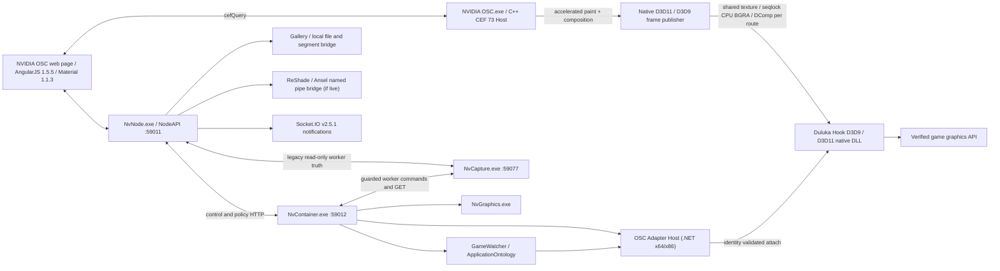

# ShadowPlay NEXT — OSC / Backend FULL Architecture & Runtime Audit

**วันที่:** 25 ตุลาคม 2026 (Asia/Bangkok)  
**เครื่อง:** AORUS-DESKTOP  
**Repo:** `C:\My Project\NVIDIA-Shadowplay` — branch `Stable` ณ เวลาตรวจ  
**ขอบเขต:** OSC CEF/Angular, UI Mods, NVIDIA NodeAPI, NvContainer, NvCapture, NvGraphics, OSC Adapter, Duluka Hook, Security, API, Lifecycle, Deploy, Diagnostics  
**รูปแบบ:** Read-only source/runtime audit; สร้างเอกสารและเครื่องมือสแกน Route เท่านั้น; ไม่แก้/Deploy/Restart แอป, ไม่จับหน้าจอ/เสียง, ไม่ Inject เกม และไม่เรียก POST ที่เปลี่ยน state

> **อ่าน `Project/Overlay On-Screen Control/NVIDIA NodeAPI/osc/mods/อ่านก่อนทำ UI.md` แล้ว**. ยึด Native NVIDIA OSC, AngularJS Material, Owner เดียวของ geometry และหลักฐาน Source/Build/Runtime/CEF แยกจากกัน.
>
> **ต้องแยกคำว่า Source / Build / Runtime HTTP / Hardware/CEF real visual / Game live** ทุกครั้ง. HTTP 200, Synthetic Test PASS, Script loaded และ Native callback count เป็นคนละชั้นหลักฐาน.

## 1. ภาพใหญ่ — สถาปัตยกรรมที่ตรวจพบ



**Control plane:** OSC UI `/index.html` → REST/Socket.IO NodeAPI `:59011` → validated Container `:59012` → NvCapture `:59077`, GPU/Watcher/Adapter.  
**CEF Native lane:** Angular calls `window.cefQuery`; C++ `HandleOscQuery` owns FPS, render preference, display monitor, input/OSC show-hide and shared storage.  
**Media plane:** actual DXGI/FFmpeg/native NVENC and WASAPI belong to NvCapture; CEF frames + Desktop compositor/frame publisher + game Hook belong to native OSC Host/Adapter/Hook. NodeAPI is not a GPU renderer, game injector or video encoder.  
**Gallery plane:** Recording directories → NodeAPI scanner/meta/thumbnail/MediaSource segment APIs → CEF Gallery UI. No guarantee of real A/V sync from HTTP segment success.

## 2. Running processes and source ownership

| Runtime | Ownership / main source | Purpose | Verified |
|---|---|---|---|
| `NVIDIA OSC.exe` | `Project/Overlay On-Screen Control/NVIDIA OSC/src/osc_main.cpp` | CEF off-screen browser, desktop GPU Present/compositor, input, native query, frame publisher | Process instances active; source inspected; **not visually exercised during audit** |
| `NvNode.exe` child of `NVIDIA Web Helper.exe` | `Project/Overlay On-Screen Control/NVIDIA NodeAPI/index.js` | HTTP API, OSC web assets, route facade, Socket.IO | Port :59011 HTTP 200 |
| `NvContainer.exe` | `Project/NVIDIA Container/NvContainer.cs`, `Components/Diagnostics/ContainerTestApi.cs` | process supervision, GameWatcher, policy, capture and adapter routing | Port :59012, core GET routes 200 |
| `NvCapture.exe` | `Project/NVIDIA Capture/src/**/CaptureRestApiServer.vb`, `EngineCapture/` | actual capture/encode/audio/file outcome | Port :59077 GET health/state/engines/displays 200 |
| `NvGraphics.exe` | `Project/NVIDIA Graphics/NvGraphics.App/` | GPU runtime and Windows GPU preference / profiles | Container GPU graphics status 200 / ready=true |
| `NVIDIA OSC Adapter.exe`, `NVIDIA OSC Adapter Hook.dll` | `Project/NVIDIA Adapter/OSC Adapter/Program.cs`, `Duluka Hook/src/` | managed attach/identity/x64-x86 and native Hook composition | Container adapter status 200; activeCount=0 during audit |
| `nvsphelper.exe` | `Project/NVIDIA Container/NVIDIA ShadowPlay Helper/` | hotkey/input relay owner | Process active; no hotkey mutation during audit |
| `Duluka.Server.exe` | `Server/` | separate server-side subsystem | Several instances observed; **not implied part of OSC loopback API** |

Other same-named instances or launcher children must be resolved by exact executable path/PID; never infer ownership from process basename alone.

## 3. Web / UI loading lifecycle

1. NvNode initializes `localApiSecurity`, mounts ReShade read-only installer routes, provides `/mods/list` allowlist, and `express.static(osc/)` on same-origin loopback.
2. CEF opens the NodeAPI-hosted `/` or `/index.html`, **not** `/osc/index.html` as a guaranteed live UI route.
3. `osc/index.html` loads `vendor.js` (AngularJS 1.5.5, Angular Material 1.1.3), `common.js`, `app.js`, explicit UI Mods + locale helpers + Gallery MSE bridge. Host integration loads listed extras from `GET /mods/list` (verify actual CEF once per mod).
4. Angular strict dependency injection + UI-Router powers native routes. Material controls must be in Angular-compiled scopes: `$compile` required when extending existing Settings through DOM.
5. Native `cefQuery` returns Node info for port 59011; Socket.IO carries validated events (GPU status, hotkeys, Record lifecycle); C++ Host owns open/close, keyboard, FPS, frame publishing.
6. Native Settings shell: `osc-content`, `osc-bread-crumb`, `nv-osc-tile`, `preferences-root-panel`, `osc-side-buttons`; prefer `md-select`, `md-switch`, `md-tabs`, `md-input-container` over raw generic form controls. Refer to `osc/mods/อ่านก่อนทำ UI.md` before editing.

**Six explicit UI states in current mods**: `main.customize-main-menu`, `main.gpu-profiles`, `main.osc-capture-advanced`, `main.osc-fps`, `main.osc-hook`, `main.osc-renderer`. Other pages inject panels into native Settings; existence of a file in `mods/` does not automatically mean CEF loaded it.

## 4. Static NodeAPI REST inventory (all direct literals indexed separately)

A read-only scanner created `docs/osc/OSC-BACKEND-ROUTE-INVENTORY-20261025.md`: **336 declared `app.get/post/put/patch/delete/all` paths in 20 JS files**. No method+literal-path collision among these 336 direct declarations. This excludes dynamic `app.use` matching routes, Socket.IO events, native CEF commands and upstream .NET/VB routes.

| Source owner | Explicit route declarations | Character |
|---|---:|---|
| `NvShadowPlayAPI.js` | 111 | Legacy NVIDIA ShadowPlay protocol/controller API; real behavior depends on Native Addon/facade |
| `NvBackendAPI.js` | 63 | Node/GFE backend, health, account/runtime plumbing |
| `NvCameraAPI.js` | 47 | NVIDIA Ansel/Camera facade |
| `index.js` | 26 | Bootstrap, security, ContainerEvents, GPU relay, HTTP bridge, static asset and local utility routes |
| `NvGalleryAPI.js` | 21 | Gallery recents, metadata, thumbnail, playback segments, CopyFile; delete intentionally unavailable |
| `NvSDKAPI.js` | 20 | SDK integrations |
| `NvGameStreamAPI.js` | 10 | Legacy GameStream facade |
| `NvAccountAPI.js` | 8 | Legacy account interface; don't infer current cloud Login backend |
| Others `NvAbHub`, Downloader, DriverInstall, etc | Remaining | Legacy/shim/compatibility routes |

### Additional dynamic/facade paths

- `shims/route-floor.js` has **78 unique route-like path literals** found by the cross-plane scanner, including `/ShadowPlay/v.1.0/Record/Enable`, `/Record/Running`, `/Record/Settings`, `/InstantReplay`, `/Audio`, `/Microphone`, `/Hotkey`, `/Duluka/v.1.0/State`, `/Actual`, `/DulukaCapture/v.1.0/settings`, `/Notifier/v.1.0/settings` and `/OBS/v.1.0/*`. **78 is not a distinct Express-registration count**; dynamic/regex paths and relay targets are included.
- `shims/game-filter-route.js` exposes `/Duluka/v.1.0/GameFilter/{Settings,State,Focus}` and Ansel bridge, using named pipe `\\.\pipe\NVIDIAAnsel.<pid>.<...>`.
- `shims/reshade-installer-route.js` has `/Duluka/v.1.0/ReShade/Installer/{Info,Inspect}` read-only preflight; no native DLL install/write route.
- `shims/capture-runtime-status.js`: NodeAPI `GET/POST /DulukaCapture/v.1.0/status`; lightweight `ready=true` is **not** full worker capability proof.
- `shims/capture-engine-status.js`, `capture-capabilities.js`, `capture-display-routing.js`: NodeAPI `GET /DulukaCapture/v.1.0/{engines,capabilities,displays}`; guarded write relays require separate conditions.
- `shims/performance-route.js`: `/Duluka/v.1.0/Performance/Query`.
- REST contract callers must use **exact method**. 200 on old routes can mean persisted setting, desired state, fixture-backed data, or shim response—not real recording/injection/graphics side effect.

## 5. Native CEF bridge inventory

C++ `osc_main.cpp` contains **25 distinct `QUERY_*` symbols** during static scan. Major groups:
- OSC display/open/close: `QUERY_OSC_GET_OPEN_STATE`, `QUERY_WIN_OPEN_OSC`, `QUERY_WIN_CLOSE_OSC`, `QUERY_OSC_REGISTER_CLOSE_EVENT`
- Output/FPS/GPU: `QUERY_OSC_GET_FPS`, `SET_FPS`, `GET_RENDERERS`, `SET_RENDERERS`, `GET_RENDER_MODE`, `GET_HOOK_TRANSPORT`, `SET_HOOK_TRANSPORT`, `QUERY_OSC_DESKTOP_MONITORS`, `SET_DESKTOP_MONITOR`
- Input/CEF presentation: `QUERY_OSC_SET_PAINTING`, `SET_KEYBOARD_CAPTURE`, `SET_DISPLAY_RECTS`, `SET_NOTIFIER_RECTS`, `SET_PICKER_MODE`
- Node bootstrap/l10n/storage: `QUERY_WIN_NODE_INFO`, `QUERY_LOAD_STRING_TABLE`, `QUERY_READ_SHARED_STORAGE`, `QUERY_WRITE_SHARED_STORAGE`
- Source `HandleOscQuery` parses JSON command and dispatches; CEF `CefMessageRouterBrowserSide::Handler::OnQuery` forwards replies to UI thread.
- `osc_main.cpp` retains a **second unreachable `QUERY_WIN_NODE_INFO` branch** after the first branch has already returned, a clean-up candidate, not a reason to expose old pairing values.

**Do not confuse `QUERY_OSC_SET_FPS` with observed unique-image FPS.** The native Host owns CEF/compositor callbacks and actual GPU pixels separately.

## 6. Container / Capture API contract

```
OSC UI
  | REST GET, POST settings
  v
NodeAPI :59011
  | GET /DulukaCapture/v.1.0/{status,engines,capabilities,displays}
  v
NvContainer :59012
  | GET /v1/capture/{status,engines,capabilities,displays}
  | guarded POST /v1/capture/record/{start,stop}
  | guarded POST /v1/capture/display/select, /screenshot
  v
NvCapture :59077
  | GET /health, /state, /engines, /displays
  | guarded POST /record/{start,stop}, /display/select, /screenshot
  v
DXGI/Duluka or FFmpeg capture backend / WASAPI / NVENC / verified file
```

Read-only requests during audit returned **HTTP 200** for NodeAPI status/engines/capabilities/displays, Container equivalents/status, and NvCapture health/state/engines/displays.

### Live Capability Truth (25 Oct)

| Check | Observed |
|---|---|
| Container capture runtime enabled / worker ready / runtime ready | **true / true / true** |
| Container capture availability / policyValid / workerTruthAvailable | **Available / true / true** |
| Actual recording session at audit time | **false**, no active backend |
| Worker `/health` / `/state` | ready=true, recording=false, enabled=false |
| Duluka provider | routeWired=true; runtimeReady=true; capabilityVerified=true; **hardwareVerified=false** |
| FFmpeg provider | routeWired=true; **runtimeReady=false**; capabilityVerified=true; hardwareVerified=false |
| OBS and NVIDIA providers | routeWired=false; runtimeReady=false |
| Replay | **Unavailable**, commandSupported=false |
| Screenshot in current Container Status contract | **Unavailable**, commandSupported=false **despite read-only displays endpoint working** |
| Source/Built capture engine policy | Build `NVIDIA Config/capture-engines.json` **now exists** and Container policyValid=true (older report said absent) |

**Caution:** `GET /DulukaCapture/v.1.0/status` returns `{enabled:true, ready:true, recording:false}`; this is a compatibility facade, not an end-to-end recording assertion. `selected.policyOnly=true` is a baseline policy, not actual worker-selected backend. No real recording/screenshot was initiated in this audit.

**Desired vs actual:** `route-floor.js` stores requested `/ShadowPlay/v.1.0/Record/Enable` desired state. `/ShadowPlay/v.1.0/Record/Running` should use worker truth. `/Duluka/v.1.0/Actual` receives actual capture transition and only emits success toast after verified outcome, not on a boolean toggle. `shims/capture-manager.js` contains an older ffmpeg watchdog/spawn implementation but **no importer/installer call from NodeAPI top-level *.js was found**; do not advertise it as the active capture engine.

## 7. GameWatcher / Graphics / Hook

**Live GameWatcher status:** enabled=true, running=true, catalogReady=true, catalogReachable=true; ApplicationOntology catalog **v1.2.9, 23 games**; candidateProcessCount=0, matchedGameCount=0 during audit.

**Live OSC Adapter status:** enabled=true, `dx9AutoHookEnabled=true`, `dx9HostContractReady=true`, `dx9TestTargetsConfigured=2`, `dx9AutoHookEligible=true`, `dx9ExVerified=false`, `activeCount=0`. Do not interpret eligible as a current in-game Hook; the identity flags need owner review (`requireVerifiedIdentity=false` and `dx9RequiresVerifiedIdentity=false` observed).

**API-specific policy based on C++ source and dated tests:**

| API | Implementation evidence | Current risk |
|---|---|---|
| Classic D3D9 CPU | Native Hook/Renderer + shared BGRA / seqlock bridge; synthetic passes | User reports real-game stutter; 60 FPS steadiness **not certified** |
| Classic D3D9 Windowed GPU | Opt-in DWM/DirectComposition external presentation; Floating Point visual pass (historical) | Not true Fullscreen Exclusive GPU Hook; frame-times/smoothness unverified |
| Classic D3D9 Fullscreen GPU | No proven production shared GPU path | Not certified |
| D3D9Ex CPU | Native Hook/Renderer smoke pass | Game-specific pass incomplete |
| D3D9Ex GPU mailbox | Isolated GPU IPC/mailbox tests | Not enabled/verified as in-game production route |
| D3D11/DXGI | Shared texture/keyed mutex Hook/Renderer, native tests | Intermittent native smoke crash history; safe unload/long session unverified |
| D3D10, D3D12, Vulkan, OpenGL | Planned folders, probes only | Native Hook/Renderer **not implemented** |

The latest D3D9 zero-frame fast-skip candidate passed synthetic tests but **was NOT deployed** according to `Duluka Hook/docs/HOOK-STATUS-EVIDENCE-2026-10-25.md`. Do not treat candidate .dll as installed runtime.

## 8. CEF / OSC FPS and frame freshness — critical

**Isolated CEF 73 test, 25 Oct 2026:** Request 75/120/240 FPS changed accelerated callback cadence, **but only ~60 distinct GPU image frames/s** in both rAF and 4ms timer workloads. Callback ≠ unique pixel ≠ Host Present ≠ Game FPS.

- Timer test at request 75: ~135.07 GPU callbacks/s but **60.09 fresh images/s**.
- At request 120: ~180 GPU callbacks/s but **60.10 fresh images/s**.
- At request 240: ~299.89 callbacks/s but **60.10 fresh images/s**.
- Experimental `--disable-frame-rate-limit`: **~250 distinct images/s** in isolated fixture independent of request, **fails bounded 75/120/240 + restore**; **not a production fix**.
- `--disable-gpu-vsync` alone still ~60 fresh images/s. CEF 73 compositor/BeginFrame scheduling candidate is source/patch-only and unbuilt as production runtime.
- Exact causal bottleneck for live DX9 stutter remains **unproven**; avoid claiming GPU pipeline inherently capped at 60 forever.

Native Host GPU/shared dirty-cadence fix has a prior separate **source + isolated test PASS but NOT DEPLOYED** report. Verify deployed SHA before changes. Do not blind-drop `dirtyRects=[]` (some content can still change).

**Required benchmark:** OSC requested FPS, CEF accelerated callback, GPU pixel serial uniqueness, Host compositor/Present, frame-bridge `frameNumber`, Hook cache/copy stats, Game Present FPS P95/P99/1%-low measured independently, OPEN/CLOSED baseline and time alignment.

## 9. Gallery / Game Filter / ReShade / Other

| Module | Verified source/recent runtime | Outstanding |
|---|---|---|
| Gallery Recents | bounded recursive scanner, actual nested recording seen in prior runtime | Very large library ordering, CEF visual listing |
| Gallery Metadata / Thumbnail / Image Dimensions | FFprobe duration HH:MM:SS, PNG/JPEG/GIF/BMP header read, actual HTTP tests previous run | Other media formats/clip editor |
| Gallery CopyFile / Remove | guarded no-overwrite copy, missing source 404; Delete 501, no fake success | Recycle Bin/explicit consent; don't silently permanently delete |
| Gallery Video Playback | MSE bridge in `osc/index.html`, /PlaybackInfo + /Media segments; video+audio HTTP 206 at 24s previously | CEF play/seek/teardown, A/V sync and transcoding latency not visually certified |
| Game Filter / ReShade Ansel | `game-filter-route.js` to per-game named pipe `AnselClient` | Not connected merely because menu exists; verify live runtime and ReShade version |
| ReShade Installer Manager | official `reshade.me` guided handoff and read-only game-folder evidence; Info 200 today | No DLL installation from NodeAPI; CEF click-through and actual installer postcheck not certified |
| NVIDIA Graphics / Profiles | Container reports NvGraphics ready, native Windows preference integration exists | Verify OS applied GPU vs chosen profile, restart persistence and route owner |
| Notifier/OBS | Socket notifications + local Notifier/OBS routes | backend ownership and actual toast only from verified saved file; OBS external integration not presumed |
| Cloud/Account/Launcher | Separate `Server/`, `Launcher.Cef/` and old NvAccountAPI facades | These are **not equivalent**; must audit identity/backend separately before claiming server Login/CBT integration |

## 10. Backend/security observations

1. `localApiSecurity.js` enforces loopback remote address, local Host, same-origin Origin/Referer and Fetch-Site; `io.eio.allowRequest` applies the analogous Socket.IO handshake restriction.
2. Same-user local processes are **not strongly authenticated** by Host/Origin. Local HTTP cookie compatibility is not a privileged IPC trust boundary. Protect mutation endpoints independently via identity, signed/paired local IPC or Windows ACL as appropriate.
3. NvContainer guarded Capture writes default denied by policy and per-request `confirmed=true`. **A diagnostic GET 200 does not permit a POST**.
4. `shims/generic-addon.js` fallback returns `callback(null,{})` for unimplemented native addon method names. This can be **false success HTTP 200** if callers do not validate results; audit each high-value write and apply explicit 501/503 when unimplemented.
5. NodeAPI has a legacy route-floor compatibility layer plus main ShadowPlay routes. Express registration order matters; identical effective paths can be handled before later modules even when the 336 direct literal scan finds no duplicate explicit method/path.
6. `QUERY_WIN_NODE_INFO` has an unreachable older secondary branch in native source after a real reply; clean separately with native regression, do not expose or propagate secrets.
7. `Process`, `Port`, `Source`, `Build`, `Runtime Worker`, `CEF Interaction`, `Final Game/Media Outcome` are **different verification gates**.

## 11. Deployment parity / regression snapshot

**Repo:** branch `Stable`, **57 changed/untracked worktree entries** at inspection; multiple agents are editing concurrently. **Do not reset/stash/copy over owners' files.**

**NodeAPI source ↔ Build hash:**
- Matching: `NvShadowPlayAPI.js`, `NvGalleryAPI.js`, `NvCameraAPI.js`, `NvBackendAPI.js`, `localApiSecurity.js`, `shims/route-floor.js`, `generic-addon.js`, `game-filter-route.js`, capture shims, ReShade shim, `osc/index.html`, `osc/app.js`, `osc/vendor.js`, `reshade-manager.js`.
- Mismatch: `index.js` differs **only in ReShade explanatory comment text** on targeted diff; `gpu-status-panel.js` hash differs but `git diff --no-index` did not show text hunks (likely newline/encoding—inspect bytes before claiming functional divergence).
- A filename in Build does not mean it is active; check module allowlist and live Runtime.
- NodeAPI has **63 `*.test.js` source test files**. A previous UI-focused run had **200 pass / 5 fail of 205 cases**; one failure is stale disabled-Install ReShade assertion, four Customize native icon/locale/tray assertions were unresolved at that audit time. **Not rerun as part of this audit**, and this is historical test evidence.
- No executable/runtime source code modified; only **three audit/inventory documents and two static scanner scripts** were written under `docs/osc/`; no runtime program touched/restarted/deployed.

## 12. Evidence directory and next-owner action list

**Automated route inventory:** `docs/osc/OSC-BACKEND-ROUTE-INVENTORY-20261025.md`  
**Cross-plane strings inventory:** `docs/osc/OSC-BACKEND-CROSSPLANE-INVENTORY-20261025.md` (route-floor 78, Container 40, Capture 9, Native CEF 25, UI source path refs 34)  
**Reproducible scanners:** `docs/osc/scan-osc-nodeapi-routes.cjs`, `docs/osc/scan-osc-crossplane.cjs`  
**This full architecture document:** `docs/osc/OSC-BACKEND-FULL-ARCHITECTURE-AUDIT-20261025.md`

**P0 — Runtime truth contracts:** review Native addon empty-success stubs; make all high-impact write endpoints fail closed. Differentiate `requested`, `persisted`, `workerReady`, `active`, `saved`. Owner: NodeAPI + Container + NvCapture.

**P0 — CEF frame freshness:** reproduce distinct GPU pixel rate and bounded FPS delivery in isolated CEF runtime; compile and validate pinned CEF scheduling candidate separately before Host integration. Owner: native OSC/CEF, not NodeAPI.

**P0 — DX9 game stutter:** compare desktop vs windowed GPU vs classic CPU with matched P95/P99/1%-low and frame age. Do not deploy unverified zero-frame candidate or bypass game protections. Owner: Hook/Native Host.

**P1 — Capture acceptance:** separately verify permitted live record, audio mux/AV sync, screenshot output, active session and saved toast, with user-consented controlled test. Replay remains unavailable. Owner: Capture + Container.

**P1 — UI compliance:** enforce `อ่านก่อนทำ UI.md`, native Settings shell/Material, avoid fixed `md-*` dimensions/global `!important`, one layout owner in Customize/Main-menu, test CEF Back/Focus/ESC/Locales. Owner: OSC/UI.

**P1 — Gallery MSE:** actual in-CEF play/seek/audio sync; control segment latency/caching; Recycle Bin deletion after explicit consent. Owner: NodeAPI/UI.

**P1 — Ansel/ReShade:** valid named-pipe session and actual runtime support; Installer Manager uses official Setup only with user confirmation. Owner: Ansel Adapter/NodeAPI.

**P2 — Deployment discipline:** staged atomic backup+hash, process path identity, each owner-specific regression, live readback after restart; no blanket deployment of source-only experimental code.

## 13. Acceptance matrix

| Layer | Verified in this audit | Not verified here |
|---|---|---|
| Files/Source | NodeAPI and native owner files inspected; generated route inventory | All 336 route behaviors/edge cases |
| JS Bootstrap/Static assets | Source contract reviewed; live NodeAPI listener | Actual CEF UI visual interaction |
| Local API GET | 20 explicit read-only probes returned HTTP 200 | Safe mutation results, privileged IPC identity |
| Worker runtime | captureReady true/idle, policyValid true, worker state, GPU/Watcher/Adapter fields | Real recording/screenshot, game-injected Hook |
| GPU frame delivery | dated 25 Oct isolated unique-pixel evidence reviewed | Installed Host unique FPS / real game frame-time |
| Tests | prior evidence referenced, audit scanner ran | Full suite and CEF/Native end-to-end acceptance |

**Bottom line:** OSC web/UI, NodeAPI, Container, NvCapture, GPU, Adapter and Hook are **integrated by route and process**. That does **not** mean feature-complete: reliability and frame freshness, real media outcomes, full CEF interaction and security guarantees remain separate acceptance gates.
