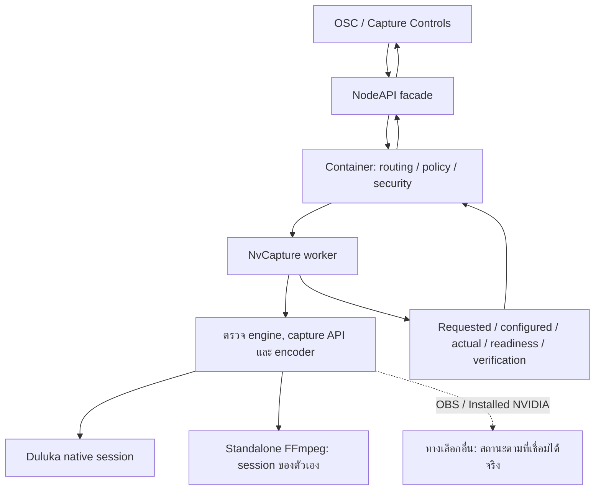
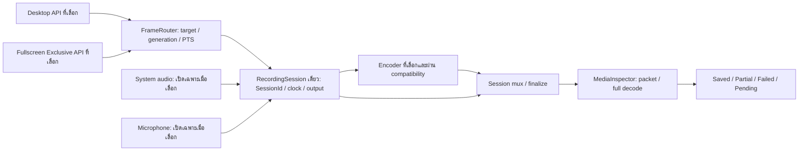

# ShadowPlay NEXT — Capture ปัจจุบันและโครงสร้างเป้าหมาย

วันที่ 28 ตุลาคม 2026 · อ้างอิง source ใน `Stable` ไม่ใช่การยืนยัน production runtime

สัญญาหลักคือ [SESSION-CENTRIC-RECORDING-CONTRACT.md](../../architecture/SESSION-CENTRIC-RECORDING-CONTRACT.md) และ [คำอธิบายภาษาไทย](../../architecture/SESSION-CENTRIC-RECORDING-TH.md) ข้อความด้านล่างไม่แก้หรือแทนสัญญา รายการที่เป็น design slot ยังไม่เท่ากับฟังก์ชันที่เปิดใช้จริง

## 1. เส้นทางควบคุมและสถานะที่ตั้งใจใช้

ใน source Direct HTTP รับ Duluka และ FFmpeg; OBS ถูกปฏิเสธ และ Installed NVIDIA เป็น policy slot ที่ Direct HTTP ยังไม่รองรับ จึงไม่ถือว่าทั้งสองเส้นทางพร้อมใช้งานจริง การขึ้น route ใน source ไม่ยืนยันว่าระบบ production ติดตั้งและรัน code ชุดเดียวกัน

## 2. โครงสร้าง Duluka เป้าหมายตามสัญญา

ผังนี้เป็น **target architecture** ไม่ใช่การรับรองว่าการสลับ Desktop/Exclusive หรือทุก encoder ถูกต่อใน native production แล้ว FrameRouter ปัจจุบันมี implementation สำหรับ owned/source-frame path แต่ `CaptureSession.Run()` ของ native ยังใช้เส้นทาง DXGI โดยตรง ไม่ควรตีความว่า automatic source switching ใช้งานได้ครบ

## 3. Source ปัจจุบันและขอบเขตหลักฐาน

| ส่วน | สถานะที่ตรวจพบ |
| --- | --- |
| Native Duluka | route policy รับ DXGI Desktop Duplication + NVENC H.264; ต้องตรวจ GPU/target ที่ใช้งานจริง |
| FrameRouter / source generation | มี implementation และ synthetic tests สำหรับ owned/source-frame path; ยังไม่ใช่หลักฐานว่า native live source switching ครบ |
| Intel QSV | มี native bridge/package และ test seam แต่ live provider ยังถูก gate ด้วย `intel_native_live_input_not_verified`; ABI ผ่านไม่เท่ากับบันทึกจริงผ่าน |
| WGC monitor / Exclusive switching | ไม่ยืนยันว่า wired และทดสอบจริงสำหรับ recording monitor/game; WGC ของ Overlay ไม่ใช่หลักฐานว่าเป็น recorder source |
| Audio | native session มี `AudioEngineSession` / WASAPI และ audio transport; live microphone/system audio ไม่ได้ทดสอบในรอบนี้. Owned-frame path ปฏิเสธ audio; `FFmpegBackend/AudioSidecar.vb` เป็น stub ซึ่งต่างจาก native WAV sidecar |
| Mux และ media | มี session mux และ media verifier; synthetic full-decode tests ใช้ข้อมูลที่สร้างขึ้นเอง ไม่ใช่หลักฐาน production recording |
| Standalone FFmpeg | มี route แยกและ pipeline ของตนเอง; capability ที่ binary โฆษณาไม่ใช่ hardware หรือ media verification |
| OBS / NVIDIA external | ต้องยืนยัน adapter และ runtime ของแต่ละ engine; ห้ามตีความ policy slot เป็น readiness |

## 4. สถานะ staging และ safety gate

ชุด staging อยู่ภายใต้ `build_test`; manifest ระบุ `hardwareVerified=false`, `mediaVerified=false`, `deployed=false`. ห้ามนำ hash เก่ามาอ้างว่า source ที่เปลี่ยนภายหลังถูกบิลด์แล้ว ต้องตรวจ manifest/source อีกครั้งหลังแก้ source ทุกครั้ง

Production Capture/Container/NodeAPI และการบันทึกจริงยังไม่ถูกยืนยันในรอบเตรียมนี้ การ deploy ต้องผ่านการตรวจ idle จากข้อมูลที่เชื่อถือได้, hash, backup, rollback และช่วง restart ที่ผู้ใช้ยืนยัน Worker รุ่นเก่าไม่มี truth schema ที่ gate ใหม่ต้องการ จึงต้องวางแผน migration ที่ไม่แปลงสถานะ Unknown เป็น Idle ก่อนดำเนินการ

## 5. การเตรียม source และ staging รอบนี้

- `RecordingEngine` ปฏิเสธความละเอียด manual ที่ใหญ่กว่าภาพต้นทาง แทนการเปลี่ยนคำขอเป็น native โดยอัตโนมัติ; ทดสอบผ่าน fake composition backend โดยไม่เปิดอุปกรณ์จริง
- เพิ่ม terminal-fault evidence จาก DXGI backend ให้ native `CaptureSession` ยุติและรักษาสาเหตุเมื่อ source fault ร้ายแรง: static no-update ยังคงเป็นพฤติกรรมปกติ. หาก worker ไม่หยุดภายในเวลาที่กำหนด ให้บันทึก fault และห้าม Saved. Synthetic native session ผ่าน 16 กรณี ทั้ง fault ก่อนเฟรมแรก ระหว่าง session และขณะ Stop พร้อม full decode ของไฟล์ทดสอบ; worker lifecycle แบบไม่ใช้อุปกรณ์ผ่าน 5/5
- Session contract 35/35 และ synthetic media/full decode 43/43 ผ่านบน build แยก ข้อมูลทดสอบสร้างขึ้นเอง ไม่เปิด GPU, จอ หรืออุปกรณ์เสียง
- `Test-CapturePredeployIdle` ตรวจ truth และชนิดข้อมูลอย่าง fail-closed; fixture 34/34 ผ่าน. Worker รุ่นเก่าที่ไม่มี schema จะไม่ผ่าน gate นี้ ซึ่งเป็น migration blocker จริง ไม่ใช่การอนุญาตให้ข้าม gate. การอ่าน status หลาย request ไม่ atomic และต้องคุม owner/commands กับตรวจซ้ำก่อน stop
- Fresh unified Release staging: `build_test/NVIDIA Capture Unified_Test/codex-prepare-20261028-final-02`, source SHA-256 `3C755DA56F11AF40FCE8D91BA84068AA0F8FE3DBCA1DF88A6A38CEAE9BDD1F78`; `NvCapture.dll` SHA-256 `60659024A8DD6876FD1374497FCBB7B4F53BB9E9DB7D3F5E0AA570ED5C41BECF`. มี 45 ไฟล์และ QSV ABI 3; source/manifest recheck ผ่าน, `hardwareVerified=false`, `mediaVerified=false`, `deployed=false`. ตรวจแผน static กับ Container/Node bundle ผ่าน 61 ไฟล์ ไม่รวม config; ไม่ใช่ live preflight
- ข้อจำกัดสำคัญ: fault DXGI/driver จริงยังไม่ได้ทดสอบ; การคงเฟรมระหว่าง AccessLost ที่กู้คืนได้ยังไม่มี gap policy ครบ. ไม่สรุปว่าปัญหานี้ปิดครบจาก synthetic tests
