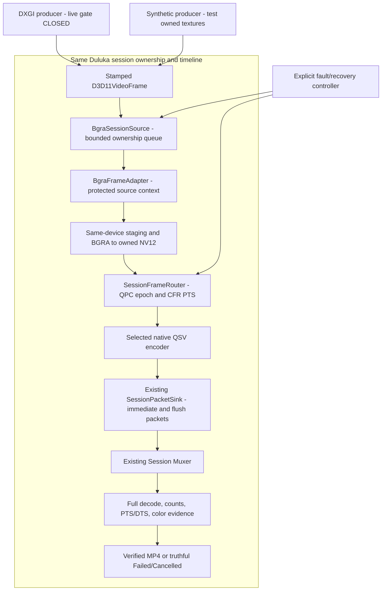

# Intel Duluka Capture — I3-B implementation and evidence

**2026-10-25, Asia/Bangkok · HUAWEI-MateBook · `intel/duluka-capture`**

Requested synthetic lifecycle/session integration is implemented and verified:
**2,056 Passed / 0 Failed / 33 Skipped**. This retains the **1,725/0/33** composition
baseline and adds **331** lifecycle/clock/ownership/recovery/color assertions.
**13 synthetic audio mux assertions are Not Run and are not counted as passed.**
Scoped Release and native Release passed; capture Release passed with 3 existing
warnings. **Live Intel remains blocked by `intel_native_live_input_not_verified`.**

No Desktop/game pixels, real system/microphone audio, capture worker, live DXGI
duplication/acquisition, AORUS, Windows GPU settings, Git stage/reset/commit/push
or deployment was used. Actual D3D11/QSV runs use owned synthetic textures only.

## Architecture and compatibility

The mandatory documents and current DdagrabBackend, D3D11VideoFrame, adapter,
staging transport, router and engine were audited. Branch/status and root-agent
inventory were checked before editing. Accepted canonical invariants were not
changed; implementation is additive to the existing session graph:



The source never creates a recording engine, file, encoder, audio pipeline or
session clock. The session selects the QPC epoch and encoder PTS. Source capture
API and encoder choice remain independent after compatibility checks. Production
Desktop factory/REST readiness remains disabled. No NVENC vendor source changed.

Original public frame/adapter/envelope constructors and converter/verifier entry
signatures are retained as delegating overloads; new source-stamp/color contracts
are additive. A reflection assertion verifies key old constructor signatures.
The Intel private C ABI intentionally changes **2→3** for optional color data:
native/managed artifacts must rebuild together, with explicit ABI mismatch failure.
Legacy unspecified-color profiles keep the old parameter path; NVENC defaults and
the shared `IEncoderBackend`/`IVideoFrame` floor are preserved.

## Source changed in this task

Paths relative to `Project/NVIDIA Capture/EngineCapture/`:

| Source | Concrete change |
| --- | --- |
| `Duluka Capture/Video/Contracts/DulukaEngine.Video/Contract/SourceLifecycle.vb` | NEW stamped-frame/fault-sink contracts, monotonic generation allocation, tested QPC100ns conversion, immutable BT.709 Limited/Full descriptor |
| `Video/DXGI Desktop Duplication/.../D3D11VideoFrame.vb` | Actual target/generation stamp constructor; old constructor and resource disposal retained |
| `Video/DXGI Desktop Duplication/.../DdagrabBackend.vb` | Idle generation reservation; stamp actual output/generation; allocate on duplication recreation; optional lifecycle fault notifications; reuse tested signed QPC conversion. No new capture API/device/fallback |
| `Video/Transport/.../BgraSessionSource.cs` | NEW bounded sink ownership and single-reader lifecycle, source generation/target/device/sequence checks, explicit bounded recovery, cancellation/queue drain/serialized teardown; preserves raw source QPC |
| `Video/Transport/.../BgraFrameAdapter.cs`, `BgraStagingTransport.cs` | Optional color descriptor through existing protected same-device conversion, owned NV12 color; old constructors retained |
| `Video/Contracts/.../Conversion/BgraToNv12Converter.vb` | Explicit BT.709 Full Range overload; original Limited overload retained |
| `Recording/DulukaEngine.Recording/SessionFrameRouter.vb` | Session-owned raw-QPC epoch/CFR normalization, jitter/gap checks, authorized generation transition preserving session time; borrowed NV12 metadata view |
| `RecordingEngine.vb`, `CaptureSession.OwnedFrames.vb`, `CaptureSession.vb` | `StartSourceSession` through the SAME engine/session path; source read→router→existing encoder/mux; stop wake-up, source counters/status, required color acceptance |
| `RecordingDTOs.vb`, recording project | Optional color config and source result/status evidence; transport project reference |
| `Composition/EncoderConfigurationPolicy.vb`, common `EncoderConfig.vb` | Explicit color propagation for Intel; unsupported provider requests rejected without changing legacy defaults |
| `Encoding/Intel/Native/qsv_bridge.cpp`, native build script | ABI 3; official VPL VideoSignalInfo buffer and GetVideoParam color validation; version output updated |
| `Encoding/Intel/.../NativeMethods.cs`, `QsvEncoderBackend.cs` | Checked ABI 3 color argument, per-frame color contract before native submission |
| `Recording/Media/.../SessionMediaVerifier.vb`, media project | Add color-aware verification using shared video descriptor; old Verify API retained; full decode/timeline/count checks unchanged |
| `QsvNative.Tests/I3B.cs`, `Program.cs` | New synthetic lifecycle/session/fault/color tests under `--i3b`; existing default/I3 entrypoints unchanged |
| `Encoding/Intel/README.md`, this report/runner and I3B handoff | Current ABI/compatibility and reproducible evidence |

`source-manifest.json` lists exact paths/SHA256. `before-source-hashes.json` and
`changed-source-hashes.json` retain the pre-edit comparison. Two documentation
files outside this task (`docs/README.md`, `docs/README-COVERAGE-MATEBOOK-20261025.md`)
changed concurrently and were preserved; they are not attributed to this work.
Canonical contract/Thai companion and NVENC sources remain unchanged in that
comparison. No working-tree reset or overwrite was used to isolate this phase.

## Ownership and lifecycle

1. A producer owns each stamped raw frame until TryPush. `Pushed` transfers to
   BgraSessionSource; `Dropped` leaves it upstream for disposal. Capacity is bounded
   (default 4); no queue-full exception, replacement device or silent eviction.
2. The consumer owns a dequeued raw frame during conversion. The existing adapter
   derives the real texture device, verifies output/LUID, requires established
   context protection and pairs Enter/Leave. Same-LUID foreign-device and shared
   texture inputs remain rejected without an implemented sharing protocol.
3. Conversion finishes copy/map/unmap into independent NV12 before raw GPU frame
   disposal. SessionFrameInput then owns NV12 until Submit returns. The router
   provides only a borrowed timestamp/color view; it does not take another payload
   ownership. Native QSV copies retained input into its bounded native pool.
4. Existing SessionPacketSink receives immediate and delayed/flush packets, copies
   into the same mux and disposes them. Encoder is drained before stop/finalization.
5. Stop cancels waiting/converting reads, wakes waiters and disposes queued raw
   frames. Dispose waits for the consumer/conversion before adapter/COM teardown.
   The session borrows/stops the supplied source; caller disposes it after unwind.
   A synthetic native-context gate proves Dispose does not free an in-flight frame.

`DdagrabBackend.PrepareSourceGeneration()` reserves metadata while initialized
and idle; caller uses the returned stamp to construct the sink before Start.
The next recreation consumes that reservation; later recreation gets a newer
generation. Old consumers do not opt in to lifecycle notifications. The production
worker was not started here; actual Initialize/Start/Stop driver behavior remains
a separate live acceptance gate. Legacy driver-hang forced-cleanup behavior is
not certified by these synthetic tests.

## Timestamp and recovery contract

DXGI LastPresentTime is QPC. Existing backend conversion now shares the tested
QPC→100ns routine, including signed acquire/present diagnostic deltas. Absolute
negative stamps, nonmonotonic QPC and duplicate/reordered source ordinals fail.
Source preserves original timestamps. The session router chooses first-video
epoch, validates against fixed CFR slots (half-frame jitter bound), emits monotonic
session PTS and preserves it across authorized generation changes. Larger gaps
fail as `session_source_timestamp_gap_requires_policy`, not compressed time or
fake frame progress. Source ordinal gaps and queue drops are distinct diagnostics.

AccessLost enters SourceInterrupted under a monotonic deadline. At most one
explicit recovery is allowed with newer generation, same target/topology and
same native source device. Source ordinal may reset; QPC epoch/PTS cannot. Old
callbacks are refused, stale in-flight output is disposed and never encoded.
Disconnected/output change/device removal are terminal, and a fatal event
escalates an earlier AccessLost. No source creates a replacement GPU device.

The successful recovery sample authorizes generation 7→8 at the frame-30 boundary
with continuous source QPC. The same session/encoder/mux produces 60 frames.
Device-loss signal with pending native output instead fails the old session;
the original engine factory validates/rebuilds its encoder for a NEW successful
60-frame session. This proves policy under injected signals, not physical GPU loss.

## Actual tests and builds

| Executed suite | Passed | Failed | Skipped |
| --- | ---: | ---: | ---: |
| Retained I1 safe regression | 400 | 0 | 33 |
| Retained VBR/CQP/corrupt-CBR video controls | 6 | 0 | 0 |
| Retained I2 native/session/flush/fault | 659 | 0 | 0 |
| Retained I3 transport + frame adapter composition | 660 | 0 | 0 |
| **New I3-B lifecycle/clock/ownership/color** | **331** | **0** | **0** |
| **Executed total** | **2,056** | **0** | **33** |

**Not Run:** prior synthetic audio mux 13 assertions (excluded, not added to Passed
or Skipped); actual DXGI producer/real GPU-removal/driver-hang/live-game tests.
The 33 framework skips are 28 live DXGI cases and 5 NVIDIA hardware cases on this
Intel machine. Baseline 1,725/0/33 is retained exactly; no hardware pass is inferred.

Seven final orchestration stages exit 0 in `checks.json`: native Release, I1 safe
(12 stages including main Release), retained media, I2 native, scoped Release,
I3 transport/composition and I3B. Scoped Release is **0 warnings/0 errors**. Main
Release is **0 errors/3 existing warnings** (WebRequest obsolescence and potentially
unassigned `pr`). No warning/validation was removed. `git diff --check` passes
apart from pre-existing line-ending notices.

Initial attempts exposed VB Implements ordering, a test helper name, a missing
End If and the linked DTO namespace qualifier. They were fixed, then all retained
suites were rerun. `initial-linked-dto-build-failure.log` preserves the regression
diagnostic. No assertion was deleted or relabeled as a skip to obtain the pass.

Synthetic cases cover Start/Submit/Complete/Finalize, idle and pending-frame Stop,
duplicate/gap/generation/output rejection, ownership on queue refusal/stop/fault,
same-LUID different-device rejection, AccessLost recovery, stale callbacks after
transition, fault escalation, terminal disconnect/device removal/output change,
new-session recovery and concurrent adapter disposal during conversion. Faults
are injected lifecycle events around REAL test-owned D3D11/QSV operations.

## Colorimetry and MP4 evidence

Immutable descriptor: BT.709 primaries=1, transfer=1, matrix=1; Limited/Full flag
explicit. The original converter retains Limited behavior, with an added tested
Full overload. Black/white/R/G/B Full vectors are checked, alongside retained
Limited conversion tests. Descriptor travels startup→EncoderConfig→NV12→session
view→QSV VideoSignalInfo. Runtime GetVideoParam must preserve all requested fields.

| Final native profile | Accepted/encoded/muxed/full decode | Flush packets | Color in MP4 **and elementary H.264** |
| --- | --- | ---: | --- |
| VBR Limited | 60 / 60 / 60 / 60 | 2 | BT.709 / tv |
| CQP Limited | 60 / 60 / 60 / 60 | 2 | BT.709 / tv |
| VBR Full | 60 / 60 / 60 / 60 | 2 | BT.709 / pc |
| CQP Full | 60 / 60 / 60 / 60 | 2 | BT.709 / pc |

Each uses 322×180, 30 fps timeline, 2 seconds, GOP 30/no B frames. VBR target/peak
2/4 Mbps; CQP 24. These are measured synthetic profiles, not real-time throughput.
All 60 decoded marker positions, counts, packet PTS/DTS/duration and full decode
pass. Source ownership counters show 60 raw frame disposals, zero queue loss and
no captured Desktop/audio frames. Native pending jobs/locked surfaces are zero
after flush. Flush counts vary with runtime progress; table records this final run.

Existing full-decode verifier additionally requires requested color tags in the
MP4. Tests stream-copy extract Annex-B H.264 and probe its color fields, proving
encoder VUI independently of container metadata. No FFmpeg re-encoding inserts
the tags. `lifecycle-*-result.json`, `*-source.json`, `*.mp4-color.json`,
`*.h264-color.json`, corresponding media and manifests record actual evidence.

Actual source and QSV LUID: **`00000000:0000bf60`**, output **0**, Intel UHD
**8086:9B41**, driver **27.20.100.8984**, runtime **1.34**, hardware D3D11 770.
Current metadata excludes Parsec/root and software adapters. LUID is observed for
this boot, not hardcoded. Native/managed ABI is 3; dispatcher/header source remains
pinned libvpl 2.16.0. Existing 1.34 borrowed-device-handle compatibility gate stays.

API references: [DXGI QPC frame timestamps](https://learn.microsoft.com/en-us/windows/win32/api/dxgi1_2/ns-dxgi1_2-dxgi_outdupl_frame_info),
[official pinned VPL structures](https://github.com/intel/libvpl/blob/v2.16.0/api/vpl/mfxstructures.h).
Local results, not API availability, establish the measured pass above.

## Known failures, limits and live prerequisites

CBR remains known failed/rejected; passing the corrupt-CBR negative control does
not repair it. Shared NT/keyed-mutex input, cross-device import, larger timestamp
gaps/placeholders, HDR/rotation/scaling, audio and universal Exclusive support are
not implemented/certified by this phase. Real source acquisition, actual device
removal/driver hangs, 1080p/long-run throughput and real context contention remain
Not Run. The legacy Ddagrab forced COM cleanup after its worker join budget was
not redesigned/exercised; audit that driver-hang path before live acceptance.

Before live acceptance: complete compatible producer/controller start-stop wiring
using the reserved stamp, audit producer shutdown/shared-resource restrictions,
retain exact target/device/clock validation, and obtain an explicitly approved
privacy-cleared scene/bounded scope. Validate actual DXGI→session→QSV→full-decode
media then, separately per game/API/mode. Do not remove the gate based on this
synthetic result. No automatic move to live testing is authorized.

Reproduce with installed I2 prerequisites and retained video controls:

```powershell
cd 'C:\My Project\NVIDIA-Shadowplay'
& '.\docs\reports\intel-duluka-i3b-2026-10-25\Run-Regression.ps1'
```

This runner never invokes the synthetic-audio mux suite or launches a production
worker. Missing prerequisites fail, rather than causing live capture or a silent
pass. Continue only from [I3-B handoff](../../INTEL-DULUKA-CAPTURE-I3B-HANDOFF.md).
